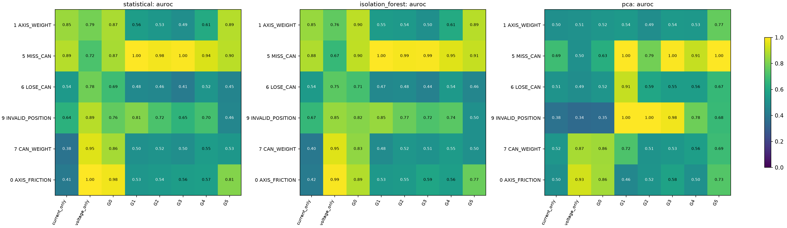
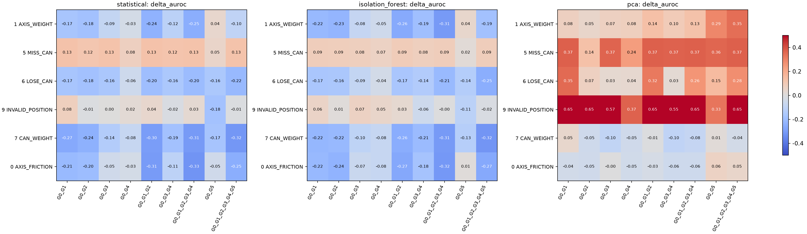
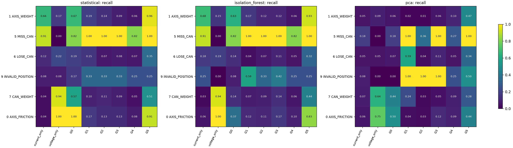
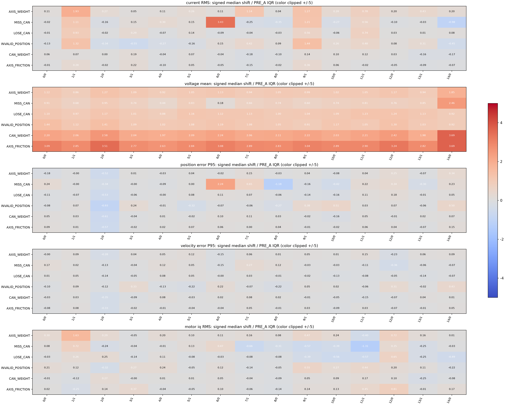
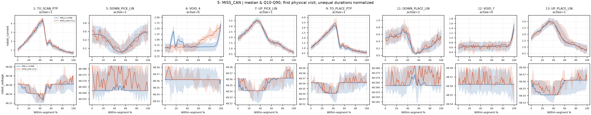
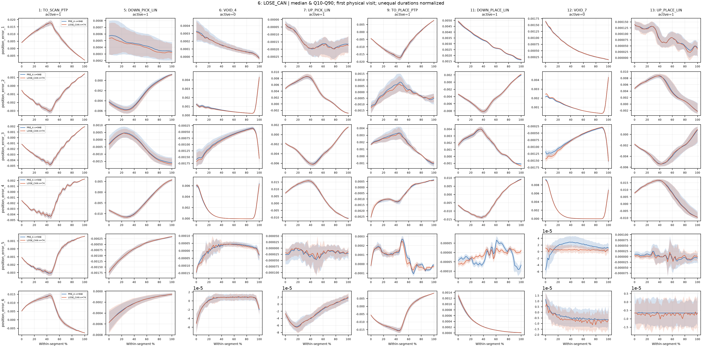
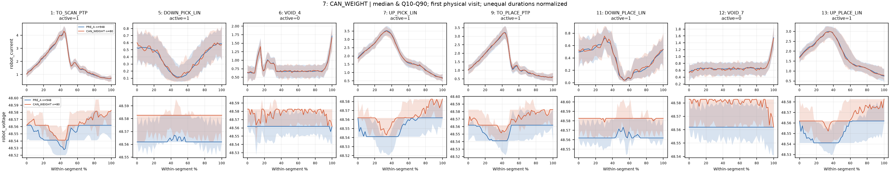
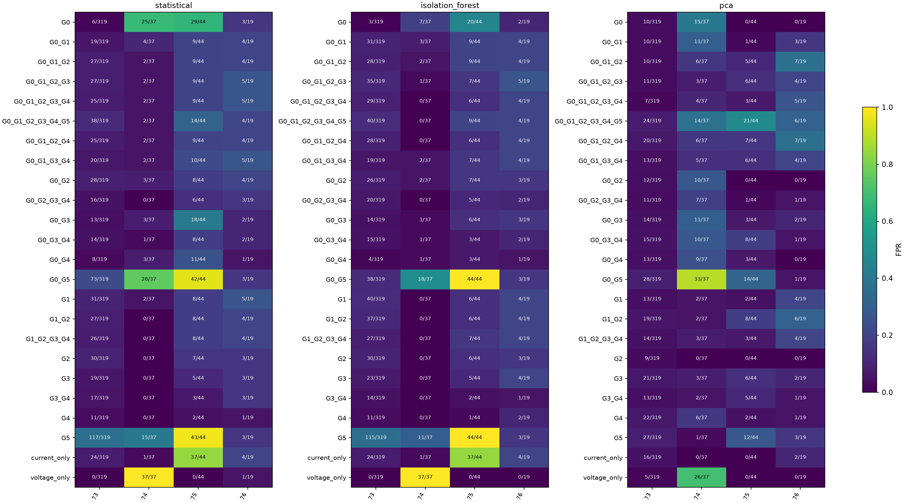

# voraus-AD 이상 유형별 특징 효과 및 Action 분석

## 1. 분석 목적 및 기존 결과와의 관계

기존 24입력×3알고리즘=72조건의 Cycle Ablation과 A/B/C×3알고리즘×Cycle/Action=18조건을 재사용했다. **새 모델 학습 0회, 임계값 변경 0회**다. 새 계산은 센서 분포, 대기 구간, 최대 변화율, 정렬 시계열이다. 기존 코드·결과·모델을 수정하지 않았다. 이전 산출물 해시는 실행 감사 JSON에 기록했다.

**모든 성능은 이미 EDA에 사용한 평가 데이터의 탐색적 재분석이며 독립 검증이 아니다.** 유형별 AUROC는 해당 이상 유형과 동일한 평가 정상 419개를 비교한다. 12종 Macro-AUROC는 유형별 AUROC의 단순 평균이다. Recall은 각 기존 모델의 정상 검증 고정 임계값을 그대로 사용한다. 유형마다 임계값을 바꾸지 않았다.

공식 `baseline_reference/voraus_ad.py`의 Category/Variant/Action을 AST로 읽었다. 정상 PRE_A 948개 중 학습711/검증237, 평가 정상419/이상755의 기존 sample 배정을 유지했다. 전처리는 기존 정상 학습분만 사용했고 이번에는 학습을 수행하지 않았다. 아래 센서 EDA의 PRE_A 참조948개는 **설명용 분포**이며 모델 전처리·임계값 계산에 추가 투입하지 않았다.

## 2. 선정한 이상 유형과 실제 실험 가능성

| category | category_name | n_cycles |
| --- | --- | --- |
| 0 | AXIS_FRICTION | 144 |
| 1 | AXIS_WEIGHT | 156 |
| 2 | COLLISION_FOAM | 72 |
| 3 | COLLISION_CABLE | 48 |
| 4 | COLLISION_CARTON | 22 |
| 5 | MISS_CAN | 11 |
| 6 | LOSE_CAN | 74 |
| 7 | CAN_WEIGHT | 80 |
| 8 | ENTANGLED | 10 |
| 9 | INVALID_POSITION | 12 |
| 10 | MOTOR_COMMUTATION | 89 |
| 11 | WOBBLING_STATION | 37 |
| 12 | NORMAL_OPERATION | 1367 |

주요 6종의 setting별 표본 수와 공식 정의:

| category | category_name | setting | variant_name | n_cycles | affected_joint |
| --- | --- | --- | --- | --- | --- |
| 0 | AXIS_FRICTION | 0 | A1_A | 10 | 1.000 |
| 0 | AXIS_FRICTION | 1 | A1_B | 5 | 1.000 |
| 0 | AXIS_FRICTION | 2 | A2_A | 10 | 2.000 |
| 0 | AXIS_FRICTION | 3 | A2_B | 11 | 2.000 |
| 0 | AXIS_FRICTION | 4 | A3_A | 11 | 3.000 |
| 0 | AXIS_FRICTION | 5 | A3_B | 6 | 3.000 |
| 0 | AXIS_FRICTION | 6 | A3_C | 8 | 3.000 |
| 0 | AXIS_FRICTION | 7 | A4_A | 13 | 4.000 |
| 0 | AXIS_FRICTION | 8 | A4_B | 11 | 4.000 |
| 0 | AXIS_FRICTION | 9 | A4_C | 6 | 4.000 |
| 0 | AXIS_FRICTION | 10 | A5_A | 14 | 5.000 |
| 0 | AXIS_FRICTION | 11 | A5_B | 17 | 5.000 |
| 0 | AXIS_FRICTION | 12 | A6_A | 8 | 6.000 |
| 0 | AXIS_FRICTION | 13 | A6_B | 14 | 6.000 |
| 1 | AXIS_WEIGHT | 14 | A1_115G | 9 | 1.000 |
| 1 | AXIS_WEIGHT | 15 | A1_231G | 9 | 1.000 |
| 1 | AXIS_WEIGHT | 16 | A1_500G | 7 | 1.000 |
| 1 | AXIS_WEIGHT | 17 | A2_500G | 7 | 2.000 |
| 1 | AXIS_WEIGHT | 18 | A2_231G | 7 | 2.000 |
| 1 | AXIS_WEIGHT | 19 | A2_115G | 7 | 2.000 |
| 1 | AXIS_WEIGHT | 20 | A3_115G | 8 | 3.000 |
| 1 | AXIS_WEIGHT | 21 | A3_231G | 7 | 3.000 |
| 1 | AXIS_WEIGHT | 22 | A3_500G | 8 | 3.000 |
| 1 | AXIS_WEIGHT | 23 | A4_500G | 8 | 4.000 |
| 1 | AXIS_WEIGHT | 24 | A4_231G | 9 | 4.000 |
| 1 | AXIS_WEIGHT | 25 | A4_115G | 13 | 4.000 |
| 1 | AXIS_WEIGHT | 26 | A5_115G | 14 | 5.000 |
| 1 | AXIS_WEIGHT | 27 | A5_231G | 10 | 5.000 |
| 1 | AXIS_WEIGHT | 28 | A5_500G | 11 | 5.000 |
| 1 | AXIS_WEIGHT | 29 | A6_500G | 5 | 6.000 |
| 1 | AXIS_WEIGHT | 30 | A6_231G | 7 | 6.000 |
| 1 | AXIS_WEIGHT | 31 | A6_115G | 10 | 6.000 |
| 5 | MISS_CAN | 45 | NO_VACUUM | 11 | — |
| 6 | LOSE_CAN | 46 | DEFECT_GRIPPER_DROP_CAN | 13 | — |
| 6 | LOSE_CAN | 47 | DROP_1400MS | 12 | — |
| 6 | LOSE_CAN | 48 | DROP_1100MS | 10 | — |
| 6 | LOSE_CAN | 49 | DROP_100MS | 4 | — |
| 6 | LOSE_CAN | 50 | DROP_200MS | 9 | — |
| 6 | LOSE_CAN | 51 | LOSE_200MS | 8 | — |
| 6 | LOSE_CAN | 52 | LOSE_300MS | 9 | — |
| 6 | LOSE_CAN | 53 | LOSE_PLACE_100MS | 9 | — |
| 7 | CAN_WEIGHT | 54 | DECREASE_95G | 13 | — |
| 7 | CAN_WEIGHT | 55 | DECREASE_165G | 13 | — |
| 7 | CAN_WEIGHT | 56 | EMPTY | 15 | — |
| 7 | CAN_WEIGHT | 57 | INCREASE_242G | 16 | — |
| 7 | CAN_WEIGHT | 58 | INCREASE_373G | 11 | — |
| 7 | CAN_WEIGHT | 59 | INCREASE_407G | 12 | — |
| 9 | INVALID_POSITION | 61 | PICK | 12 | — |

AXIS_WEIGHT는 관절 부착 하중이고 CAN_WEIGHT는 작업 물체 질량이다. MISS_CAN(NO_VACUUM), LOSE_CAN(여러 release/defect variant), INVALID_POSITION(PICK)은 서로 다른 조건이다. 설정 이름의 시간 표기는 실험 조건 식별자이며 샘플별 실제 이상 시작 시각을 검증한 것이 아니다. **모든 xArm 재현 가능성은 미확인**이다.

## 3. 이상 유형별 특징 그룹 성능 비교

G0=DC 전체 전류·전압, G1=목표/실제 위치, G2=목표/실제 속도, G3=위치 오차, G4=속도 오차, G5=관절별 motor_iq. G3/G4는 원시 위치/속도 차이에서 계산한 표현이다. DC 전류와 iq는 합산·대체하지 않는다. 아래 비교는 **같은 알고리즘 안에서** 읽는다.

단독 그룹 8종의 AUROC/Recall/FPR(모든 행 공개, 최고 조합만 선택하지 않음):

### statistical

| category_name | current_only | voltage_only | G0 | G1 | G2 | G3 | G4 | G5 |
| --- | --- | --- | --- | --- | --- | --- | --- | --- |
| AXIS_FRICTION | 0.407 / 0.042 / 0.158 | 0.999 / 1.000 / 0.091 | 0.977 / 1.000 / 0.150 | 0.526 / 0.174 / 0.110 | 0.536 / 0.132 / 0.095 | 0.557 / 0.132 / 0.064 | 0.566 / 0.076 / 0.033 | 0.813 / 0.910 / 0.425 |
| AXIS_WEIGHT | 0.849 / 0.660 / 0.158 | 0.793 / 0.173 / 0.091 | 0.872 / 0.667 / 0.150 | 0.558 / 0.192 / 0.110 | 0.528 / 0.141 / 0.095 | 0.494 / 0.090 / 0.064 | 0.610 / 0.064 / 0.033 | 0.888 / 0.955 / 0.425 |
| CAN_WEIGHT | 0.380 / 0.037 / 0.158 | 0.951 / 0.938 / 0.091 | 0.865 / 0.575 / 0.150 | 0.500 / 0.100 / 0.110 | 0.515 / 0.113 / 0.095 | 0.495 / 0.087 / 0.064 | 0.551 / 0.050 / 0.033 | 0.528 / 0.512 / 0.425 |
| INVALID_POSITION | 0.641 / 0.083 / 0.158 | 0.891 / 0.083 / 0.091 | 0.761 / 0.167 / 0.150 | 0.813 / 0.333 / 0.110 | 0.717 / 0.333 / 0.095 | 0.652 / 0.333 / 0.064 | 0.704 / 0.250 / 0.033 | 0.460 / 0.250 / 0.425 |
| LOSE_CAN | 0.537 / 0.122 / 0.158 | 0.783 / 0.216 / 0.091 | 0.689 / 0.189 / 0.150 | 0.476 / 0.149 / 0.110 | 0.464 / 0.068 / 0.095 | 0.415 / 0.081 / 0.064 | 0.520 / 0.068 / 0.033 | 0.452 / 0.351 / 0.425 |
| MISS_CAN | 0.890 / 0.909 / 0.158 | 0.717 / 0.000 / 0.091 | 0.868 / 0.818 / 0.150 | 1.000 / 1.000 / 0.110 | 0.982 / 1.000 / 0.095 | 0.996 / 1.000 / 0.064 | 0.942 / 0.818 / 0.033 | 0.896 / 1.000 / 0.425 |

### isolation_forest

| category_name | current_only | voltage_only | G0 | G1 | G2 | G3 | G4 | G5 |
| --- | --- | --- | --- | --- | --- | --- | --- | --- |
| AXIS_FRICTION | 0.416 / 0.056 / 0.158 | 0.989 / 1.000 / 0.088 | 0.886 / 0.368 / 0.076 | 0.533 / 0.118 / 0.119 | 0.545 / 0.111 / 0.093 | 0.588 / 0.167 / 0.076 | 0.559 / 0.097 / 0.033 | 0.772 / 0.833 / 0.413 |
| AXIS_WEIGHT | 0.846 / 0.679 / 0.158 | 0.755 / 0.154 / 0.088 | 0.901 / 0.628 / 0.076 | 0.548 / 0.167 / 0.119 | 0.540 / 0.115 / 0.093 | 0.499 / 0.115 / 0.076 | 0.612 / 0.058 / 0.033 | 0.893 / 0.929 / 0.413 |
| CAN_WEIGHT | 0.401 / 0.025 / 0.158 | 0.952 / 0.938 / 0.088 | 0.835 / 0.138 / 0.076 | 0.483 / 0.075 / 0.119 | 0.525 / 0.087 / 0.093 | 0.510 / 0.138 / 0.076 | 0.548 / 0.062 / 0.033 | 0.502 / 0.438 / 0.413 |
| INVALID_POSITION | 0.667 / 0.250 / 0.158 | 0.846 / 0.000 / 0.088 | 0.817 / 0.083 / 0.076 | 0.847 / 0.583 / 0.119 | 0.772 / 0.333 / 0.093 | 0.719 / 0.417 / 0.076 | 0.744 / 0.250 / 0.033 | 0.503 / 0.250 / 0.413 |
| LOSE_CAN | 0.543 / 0.176 / 0.158 | 0.747 / 0.189 / 0.088 | 0.705 / 0.135 / 0.076 | 0.467 / 0.041 / 0.119 | 0.477 / 0.068 / 0.093 | 0.439 / 0.108 / 0.076 | 0.539 / 0.054 / 0.033 | 0.458 / 0.324 / 0.413 |
| MISS_CAN | 0.882 / 0.909 / 0.158 | 0.671 / 0.000 / 0.088 | 0.905 / 0.818 / 0.076 | 0.997 / 1.000 / 0.119 | 0.985 / 1.000 / 0.093 | 0.990 / 1.000 / 0.076 | 0.951 / 0.818 / 0.033 | 0.912 / 1.000 / 0.413 |

### pca

| category_name | current_only | voltage_only | G0 | G1 | G2 | G3 | G4 | G5 |
| --- | --- | --- | --- | --- | --- | --- | --- | --- |
| AXIS_FRICTION | 0.496 / 0.062 / 0.043 | 0.934 / 0.750 / 0.074 | 0.860 / 0.500 / 0.060 | 0.462 / 0.042 / 0.050 | 0.517 / 0.028 / 0.021 | 0.577 / 0.118 / 0.076 | 0.502 / 0.090 / 0.074 | 0.733 / 0.438 / 0.103 |
| AXIS_WEIGHT | 0.499 / 0.051 / 0.043 | 0.507 / 0.090 / 0.074 | 0.524 / 0.058 / 0.060 | 0.541 / 0.019 / 0.050 | 0.490 / 0.013 / 0.021 | 0.541 / 0.058 / 0.076 | 0.532 / 0.103 / 0.074 | 0.765 / 0.474 / 0.103 |
| CAN_WEIGHT | 0.525 / 0.075 / 0.043 | 0.868 / 0.637 / 0.074 | 0.857 / 0.438 / 0.060 | 0.722 / 0.237 / 0.050 | 0.514 / 0.025 / 0.021 | 0.531 / 0.050 / 0.076 | 0.561 / 0.087 / 0.074 | 0.687 / 0.275 / 0.103 |
| INVALID_POSITION | 0.378 / 0.083 / 0.043 | 0.344 / 0.000 / 0.074 | 0.352 / 0.000 / 0.060 | 1.000 / 1.000 / 0.050 | 0.998 / 1.000 / 0.021 | 0.980 / 1.000 / 0.076 | 0.779 / 0.250 / 0.074 | 0.675 / 0.500 / 0.103 |
| LOSE_CAN | 0.514 / 0.054 / 0.043 | 0.489 / 0.054 / 0.074 | 0.520 / 0.068 / 0.060 | 0.911 / 0.595 / 0.050 | 0.593 / 0.041 / 0.021 | 0.555 / 0.108 / 0.076 | 0.555 / 0.054 / 0.074 | 0.669 / 0.338 / 0.103 |
| MISS_CAN | 0.690 / 0.182 / 0.043 | 0.501 / 0.000 / 0.074 | 0.629 / 0.182 / 0.060 | 1.000 / 1.000 / 0.050 | 0.786 / 0.364 / 0.021 | 0.996 / 1.000 / 0.076 | 0.913 / 0.273 / 0.074 | 0.997 / 1.000 / 0.103 |

G0 추가 후보의 ΔAUROC / ΔRecall / ΔFPR. B=G0_G1_G2_G3_G4, C=B_G5. 각 칸은 동일 알고리즘 G0 대비이며 음수도 그대로 보존했다. 전체24입력과 정상 fp/n는 CSV에 있다.

statistical

| category_name | G0_G1 | G0_G2 | G0_G3 | G0_G4 | G0_G1_G2 | G0_G3_G4 | G0_G1_G2_G3_G4 | G0_G5 | G0_G1_G2_G3_G4_G5 |
| --- | --- | --- | --- | --- | --- | --- | --- | --- | --- |
| AXIS_FRICTION | -0.211 / -0.722 / -0.064 | -0.200 / -0.701 / -0.048 | -0.049 / -0.375 / -0.064 | -0.033 / -0.347 / -0.095 | -0.307 / -0.743 / -0.050 | -0.107 / -0.625 / -0.091 | -0.327 / -0.764 / -0.053 | -0.049 / +0.000 / +0.198 | -0.252 / -0.576 / -0.012 |
| AXIS_WEIGHT | -0.172 / -0.385 / -0.064 | -0.184 / -0.436 / -0.048 | -0.086 / -0.327 / -0.064 | -0.034 / -0.288 / -0.095 | -0.242 / -0.436 / -0.050 | -0.115 / -0.449 / -0.091 | -0.252 / -0.442 / -0.053 | +0.042 / +0.282 / +0.198 | -0.098 / -0.179 / -0.012 |
| CAN_WEIGHT | -0.267 / -0.462 / -0.064 | -0.242 / -0.412 / -0.048 | -0.137 / -0.387 / -0.064 | -0.081 / -0.462 / -0.095 | -0.304 / -0.450 / -0.050 | -0.185 / -0.450 / -0.091 | -0.309 / -0.425 / -0.053 | -0.174 / +0.087 / +0.198 | -0.318 / -0.400 / -0.012 |
| INVALID_POSITION | +0.080 / +0.167 / -0.064 | -0.010 / +0.167 / -0.048 | +0.004 / +0.083 / -0.064 | +0.020 / +0.083 / -0.095 | +0.043 / +0.250 / -0.050 | -0.018 / +0.083 / -0.091 | +0.028 / +0.250 / -0.053 | -0.180 / +0.167 / +0.198 | -0.008 / +0.250 / -0.012 |
| LOSE_CAN | -0.171 / -0.068 / -0.064 | -0.184 / -0.135 / -0.048 | -0.162 / -0.108 / -0.064 | -0.057 / -0.149 / -0.095 | -0.198 / -0.041 / -0.050 | -0.156 / -0.135 / -0.091 | -0.205 / -0.095 / -0.053 | -0.157 / +0.135 / +0.198 | -0.218 / -0.054 / -0.012 |
| MISS_CAN | +0.132 / +0.182 / -0.064 | +0.117 / +0.182 / -0.048 | +0.127 / +0.182 / -0.064 | +0.076 / +0.000 / -0.095 | +0.130 / +0.182 / -0.050 | +0.121 / +0.182 / -0.091 | +0.129 / +0.182 / -0.053 | +0.051 / +0.182 / +0.198 | +0.129 / +0.182 / -0.012 |

isolation_forest

| category_name | G0_G1 | G0_G2 | G0_G3 | G0_G4 | G0_G1_G2 | G0_G3_G4 | G0_G1_G2_G3_G4 | G0_G5 | G0_G1_G2_G3_G4_G5 |
| --- | --- | --- | --- | --- | --- | --- | --- | --- | --- |
| AXIS_FRICTION | -0.216 / -0.104 / +0.036 | -0.237 / -0.208 / +0.014 | -0.067 / -0.125 / -0.019 | -0.082 / -0.222 / -0.055 | -0.272 / -0.181 / +0.026 | -0.178 / -0.201 / -0.026 | -0.316 / -0.229 / +0.017 | +0.009 / +0.597 / +0.169 | -0.267 / -0.174 / +0.050 |
| AXIS_WEIGHT | -0.217 / -0.340 / +0.036 | -0.230 / -0.417 / +0.014 | -0.085 / -0.340 / -0.019 | -0.054 / -0.417 / -0.055 | -0.262 / -0.391 / +0.026 | -0.191 / -0.519 / -0.026 | -0.310 / -0.494 / +0.017 | +0.044 / +0.353 / +0.169 | -0.187 / -0.346 / +0.050 |
| CAN_WEIGHT | -0.225 / -0.013 / +0.036 | -0.216 / -0.037 / +0.014 | -0.104 / +0.062 / -0.019 | -0.081 / -0.087 / -0.055 | -0.257 / -0.025 / +0.026 | -0.210 / -0.025 / -0.026 | -0.312 / -0.025 / +0.017 | -0.131 / +0.325 / +0.169 | -0.322 / -0.013 / +0.050 |
| INVALID_POSITION | +0.057 / +0.417 / +0.036 | +0.009 / +0.250 / +0.014 | +0.067 / +0.250 / -0.019 | +0.047 / +0.167 / -0.055 | +0.033 / +0.333 / +0.026 | -0.058 / +0.167 / -0.026 | -0.004 / +0.250 / +0.017 | -0.115 / +0.333 / +0.169 | -0.017 / +0.333 / +0.050 |
| LOSE_CAN | -0.166 / +0.014 / +0.036 | -0.161 / -0.014 / +0.014 | -0.086 / -0.054 / -0.019 | -0.039 / -0.095 / -0.055 | -0.165 / -0.014 / +0.026 | -0.143 / -0.095 / -0.026 | -0.212 / -0.068 / +0.017 | -0.137 / +0.122 / +0.169 | -0.253 / -0.054 / +0.050 |
| MISS_CAN | +0.089 / +0.182 / +0.036 | +0.085 / +0.182 / +0.014 | +0.082 / +0.091 / -0.019 | +0.066 / +0.000 / -0.055 | +0.090 / +0.182 / +0.026 | +0.080 / +0.091 / -0.026 | +0.088 / +0.182 / +0.017 | +0.018 / +0.182 / +0.169 | +0.088 / +0.182 / +0.050 |

pca

| category_name | G0_G1 | G0_G2 | G0_G3 | G0_G4 | G0_G1_G2 | G0_G3_G4 | G0_G1_G2_G3_G4 | G0_G5 | G0_G1_G2_G3_G4_G5 |
| --- | --- | --- | --- | --- | --- | --- | --- | --- | --- |
| AXIS_FRICTION | -0.042 / -0.111 / +0.000 | -0.049 / -0.069 / -0.007 | -0.002 / +0.014 / +0.012 | -0.047 / -0.076 / +0.000 | -0.030 / -0.118 / +0.007 | -0.058 / -0.069 / +0.021 | -0.056 / -0.139 / -0.014 | +0.065 / +0.354 / +0.122 | +0.050 / +0.299 / +0.095 |
| AXIS_WEIGHT | +0.077 / +0.019 / +0.000 | +0.050 / +0.032 / -0.007 | +0.073 / +0.096 / +0.012 | +0.080 / +0.058 / +0.000 | +0.139 / +0.103 / +0.007 | +0.096 / +0.096 / +0.021 | +0.129 / +0.141 / -0.014 | +0.292 / +0.558 / +0.122 | +0.347 / +0.635 / +0.095 |
| CAN_WEIGHT | +0.047 / +0.150 / +0.000 | -0.053 / +0.013 / -0.007 | -0.095 / -0.037 / +0.012 | -0.048 / -0.050 / +0.000 | -0.006 / +0.087 / +0.007 | -0.099 / -0.050 / +0.021 | -0.084 / -0.112 / -0.014 | +0.014 / +0.338 / +0.122 | -0.036 / +0.162 / +0.095 |
| INVALID_POSITION | +0.648 / +1.000 / +0.000 | +0.646 / +1.000 / -0.007 | +0.569 / +0.583 / +0.012 | +0.369 / +0.250 / +0.000 | +0.648 / +1.000 / +0.007 | +0.548 / +0.500 / +0.021 | +0.648 / +1.000 / -0.014 | +0.329 / +0.333 / +0.122 | +0.648 / +1.000 / +0.095 |
| LOSE_CAN | +0.354 / +0.392 / +0.000 | +0.074 / +0.054 / -0.007 | +0.034 / +0.054 / +0.012 | +0.039 / +0.000 / +0.000 | +0.321 / +0.378 / +0.007 | +0.027 / +0.054 / +0.021 | +0.259 / +0.230 / -0.014 | +0.153 / +0.338 / +0.122 | +0.276 / +0.459 / +0.095 |
| MISS_CAN | +0.371 / +0.818 / +0.000 | +0.136 / +0.273 / -0.007 | +0.366 / +0.818 / +0.012 | +0.238 / +0.182 / +0.000 | +0.371 / +0.818 / +0.007 | +0.368 / +0.818 / +0.021 | +0.371 / +0.818 / -0.014 | +0.360 / +0.818 / +0.122 | +0.371 / +0.818 / +0.095 |

유형별 해석:

- MISS_CAN: 위치 G1은 PCA AUROC 1.000, Recall1.000, FPR0.050(21/419). G0 PCA는 AUROC0.629, Recall0.182, FPR0.060(25/419). 위치를 확인할 실험 가치는 있으나 이상11개뿐이며 작업 궤적/제어 반응과 배치 효과를 배제하지 못한다.

- INVALID_POSITION: G1 PCA AUROC1.000/Recall1.000/FPR0.050. G3 PCA도 AUROC0.980/Recall1.000/FPR0.076. 파지 위치 조건12개를 구분한 결과이며 정확한 물리 원인 진단이 아니다.

- LOSE_CAN: G1 PCA AUROC0.911/Recall0.595/FPR0.050이지만 G1 Statistical AUROC0.476/Recall0.149/FPR0.110이다. **센서 효과는 모델 표현에 의존**한다. 낙하 시점이 다른 setting들을 한 유형으로 묶었으므로 setting 분포도 함께 확인한다.

- CAN_WEIGHT: Statistical 전류 단독 AUROC0.380/Recall0.038/FPR0.158, 전압 단독0.951/0.938/0.091. 전압의 높은 구분력을 물체 무게 감지의 증거로 단정할 수 없다. 질량 감소와 증가 setting을 나눠 확인해야 한다.

- AXIS_WEIGHT/FRICTION: 공식 설정에서만 대상 관절을 지정했다. 다른 유형은 6관절 전체를 유지했다. 마찰의 전압 의존성과 정상 배치 차이는 원인 식별의 대안 설명이다.

## 4. 이상 유형별 센서값 변화 분석

44신호(전류·전압, 6관절 목표/실제 위치·속도, 두 오차, iq) 각각의 평균/RMS/표준편차/절대P95/최대 절대변화율을 비교했다. 기존8통계는 캐시를 그대로 재사용했다. 새 `rate_abs_max=max(|Δx/Δt|)`는 원래 타임스탬프로 구하고 단일샘플 구간에서는 계산하지 않았다. 전체 사이클의 최대 변화율은 경계 변화도 포함하지만 구간별 변화율은 경계를 넘지 않는다. 단위는 원본 신호 단위 및 그 단위/s이며 서로 다른 물리량을 합치지 않는다.

`fault_type_cycle_comparison.csv`, `fault_type_action_comparison.csv`는 12종×5정상배치 비교다. `cycle_setting_comparison.csv`, `action_setting_comparison.csv`는 주요6종의 각 setting을 PRE_A에 비교한다. 대상 관절/나머지 관절을 `joint_role`로 구분했고 파지 유형은 `unspecified_joint`다. 각 행의 n, 중앙값/Q10/Q90, 차이, 비율, PRE_A IQR 대비 차이 및 정상 중앙80% 안에 들어오는 이상 사이클 비율을 함께 읽는다. 이 비율은 두 확률밀도의 완전한 겹침 면적이나 분류 정확도가 아니다. IQR≤1e-12 또는 기준 중앙값≈0에서는 각각 표준화 차이/비율을 결측 처리했다. 작은 IQR은 큰 표준화 차이를 만들 수 있다.

Cycle의 전류RMS·전압평균 (PRE_A 참조, 원본 단위):

| category | feature | n_fault_cycles | n_normal_cycles | fault_median | normal_median | fault_q10 | fault_q90 | normal_q10 | normal_q90 | fault_fraction_in_normal_q10_q90 |
| --- | --- | --- | --- | --- | --- | --- | --- | --- | --- | --- |
| 0 | robot_current__rms | 144 | 948 | 1.223 | 1.222 | 1.199 | 1.247 | 1.198 | 1.244 | 0.785 |
| 0 | robot_voltage__mean | 144 | 948 | 48.579 | 48.560 | 48.577 | 48.581 | 48.555 | 48.566 | 0.000 |
| 1 | robot_current__rms | 156 | 948 | 1.268 | 1.222 | 1.241 | 1.296 | 1.198 | 1.244 | 0.135 |
| 1 | robot_voltage__mean | 156 | 948 | 48.567 | 48.560 | 48.563 | 48.572 | 48.555 | 48.566 | 0.397 |
| 5 | robot_current__rms | 11 | 948 | 1.275 | 1.222 | 1.265 | 1.304 | 1.198 | 1.244 | 0.091 |
| 5 | robot_voltage__mean | 11 | 948 | 48.565 | 48.560 | 48.564 | 48.566 | 48.555 | 48.566 | 0.909 |
| 6 | robot_current__rms | 74 | 948 | 1.237 | 1.222 | 1.210 | 1.257 | 1.198 | 1.244 | 0.662 |
| 6 | robot_voltage__mean | 74 | 948 | 48.567 | 48.560 | 48.564 | 48.572 | 48.555 | 48.566 | 0.486 |
| 7 | robot_current__rms | 80 | 948 | 1.219 | 1.222 | 1.200 | 1.241 | 1.198 | 1.244 | 0.825 |
| 7 | robot_voltage__mean | 80 | 948 | 48.574 | 48.560 | 48.571 | 48.576 | 48.555 | 48.566 | 0.000 |
| 9 | robot_current__rms | 12 | 948 | 1.248 | 1.222 | 1.231 | 1.260 | 1.198 | 1.244 | 0.250 |
| 9 | robot_voltage__mean | 12 | 948 | 48.567 | 48.560 | 48.567 | 48.568 | 48.555 | 48.566 | 0.000 |

전기 신호의 setting별 분포는 `sensor_distributions/`의 6개 그림을 참고한다. 박스=Q25–Q75, 수염=Q10–Q90, 바깥 점도 표시했다. 특히 CAN_WEIGHT 감소/증가를 섞은 평균만으로 결론 내리지 않는다.

공식 대상 관절이 있는0/1의 setting×Action×관절 효과 요약(행을 같은 가중치로 요약했으므로 사이클 수 가중 효과가 아님). `negative_fraction`은 정상 대비 중앙값이 감소한 행의 비율이다. 감소도 포함해 보존하며 위치 오차가 모든 조건에서 증가한다고 해석하지 않는다. 개별 setting/Action의 n와 분포는 원본 CSV에서 확인한다.

| category | joint_role | signal_family | median_effect_iqr | negative_fraction | n_setting_action_joint_rows |
| --- | --- | --- | --- | --- | --- |
| 0 | affected | motor_iq | 0.128 | 0.464 | 209 |
| 0 | affected | position_error | 0.018 | 0.469 | 209 |
| 0 | other_joint | motor_iq | 0.035 | 0.477 | 1045 |
| 0 | other_joint | position_error | -0.037 | 0.536 | 1045 |
| 1 | affected | motor_iq | 0.050 | 0.455 | 266 |
| 1 | affected | position_error | 0.020 | 0.466 | 266 |
| 1 | other_joint | motor_iq | 0.275 | 0.366 | 1330 |
| 1 | other_joint | position_error | 0.008 | 0.465 | 1330 |
## 5. 주요 Action별 특징 변화

| action | name |
| --- | --- |
| 0 | VOID_1 |
| 1 | TO_SCAN_PTP |
| 2 | VOID_2 |
| 3 | OVER_OBJECT_PTP |
| 4 | VOID_3 |
| 5 | DOWN_PICK_LIN |
| 6 | VOID_4 |
| 7 | UP_PICK_LIN |
| 8 | VOID_5 |
| 9 | TO_PLACE_PTP |
| 10 | VOID_6 |
| 11 | DOWN_PLACE_LIN |
| 12 | VOID_7 |
| 13 | UP_PLACE_LIN |
| 14 | VOID_8 |

Action/active가 바뀔 때마다 새 연속 구간으로 분리했다. 반복 방문의 실제 순서·시작/종료·샘플수는 `segment_inventory.csv`에 모두 보존했다. 1샘플 구간은 목록에 남기고 특징/보간에서 제외한다. 캐시의 유효 active 방문번호와 물리적 방문번호를 구분해 재사용했다. 반복이 있으면 비교 통계에서는 같은 사이클/Action/active의 구간 통계 중앙값으로 사이클 가중치를 같게 하며, 구간 자체를 이어 붙이지 않는다. 실제 구간 통계와 개수는 별도로 보존했다.

열=Action/active, 색=동일 구간의 (이상 중앙값−PRE_A 중앙값)/PRE_A IQR. 관절 계열은 **6개 개별 효과의 부호 있는 중앙값**으로 요약하여 방향 상쇄가 가능하다. 세부 joint CSV와 6관절 분리 그림을 함께 읽는다. 색은 ±5에서 잘랐고 원값은 CSV에 보존했다. 이는 탐지 AUROC가 아니다.

아래는 설명을 위해 각 신호 계열에서 |중앙값 차이/IQR|가 큰 두 구간을 사후 정렬한 것이다. 해당 유형 및 PRE_A의80% 이상 사이클에 유효 구간이 있는 경우만 후보에 포함했다. 모델 선택이나 임계값 결정에 사용하지 않았다. `normal_shift`는 관측한 다른 정상4배치의 동일 구간 변화 중 최대값이다(관절 계열은 그 값들의 중앙값). 이상 변화가 이보다 작으면 배치 차이만으로도 설명될 수 있다.

| category | family | action_name | active | effect | cycle_effect | normal_shift | within_normal80 | n_fault | n_normal | duration_fault | duration_normal |
| --- | --- | --- | --- | --- | --- | --- | --- | --- | --- | --- | --- |
| 0 | current RMS | TO_PLACE_PTP | 1 | 0.360 | 0.074 | 1.976 | 0.688 | 144 | 948 | 1.108 | 1.108 |
| 0 | current RMS | TO_SCAN_PTP | 1 | 0.285 | 0.074 | 2.117 | 0.729 | 144 | 948 | 1.128 | 1.128 |
| 0 | motor iq RMS | DOWN_PLACE_LIN | 1 | 0.445 | 0.385 | 1.520 | 0.389 | 144 | 948 | 0.413 | 0.413 |
| 0 | motor iq RMS | VOID_7 | 0 | 0.813 | 0.385 | 1.063 | 0.471 | 144 | 948 | 0.997 | 0.997 |
| 0 | position error P95 | VOID_1 | 0 | 0.088 | -0.087 | 0.298 | 0.735 | 144 | 948 | 0.664 | 0.655 |
| 0 | position error P95 | VOID_2 | 0 | -0.574 | -0.087 | 0.623 | 0.676 | 144 | 948 | 3.665 | 3.504 |
| 0 | velocity error P95 | VOID_2 | 0 | -0.328 | -0.024 | 0.351 | 0.738 | 144 | 948 | 3.665 | 3.504 |
| 0 | velocity error P95 | VOID_6 | 0 | -0.091 | -0.024 | 0.157 | 0.733 | 144 | 948 | 0.221 | 0.221 |
| 0 | voltage mean | VOID_2 | 0 | 3.507 | 3.330 | 2.575 | 0.000 | 144 | 948 | 3.665 | 3.504 |
| 0 | voltage mean | VOID_7 | 0 | 3.243 | 3.330 | 2.460 | 0.000 | 144 | 948 | 0.997 | 0.997 |
| 1 | current RMS | TO_PLACE_PTP | 1 | 1.272 | 1.977 | 1.976 | 0.314 | 156 | 948 | 1.108 | 1.108 |
| 1 | current RMS | TO_SCAN_PTP | 1 | 1.931 | 1.977 | 2.117 | 0.154 | 156 | 948 | 1.128 | 1.128 |
| 1 | motor iq RMS | TO_SCAN_PTP | 1 | 1.627 | 0.885 | 2.751 | 0.186 | 156 | 948 | 1.128 | 1.128 |
| 1 | motor iq RMS | VOID_7 | 0 | 0.720 | 0.885 | 1.063 | 0.460 | 156 | 948 | 0.997 | 0.997 |
| 1 | position error P95 | VOID_2 | 0 | -0.515 | -0.083 | 0.623 | 0.673 | 156 | 948 | 3.669 | 3.504 |
| 1 | position error P95 | VOID_7 | 0 | 0.255 | -0.083 | 0.444 | 0.728 | 156 | 948 | 0.997 | 0.997 |
| 1 | velocity error P95 | VOID_2 | 0 | -0.282 | -0.092 | 0.351 | 0.767 | 156 | 948 | 3.669 | 3.504 |
| 1 | velocity error P95 | VOID_7 | 0 | -0.232 | -0.092 | 0.272 | 0.803 | 156 | 948 | 0.997 | 0.997 |
| 1 | voltage mean | VOID_2 | 0 | 1.270 | 1.202 | 2.575 | 0.378 | 156 | 948 | 3.669 | 3.504 |
| 1 | voltage mean | VOID_7 | 0 | 1.173 | 1.202 | 2.460 | 0.417 | 156 | 948 | 0.997 | 0.997 |
| 5 | current RMS | TO_PLACE_PTP | 1 | 1.212 | 2.272 | 1.976 | 0.364 | 11 | 948 | 1.117 | 1.108 |
| 5 | current RMS | VOID_4 | 0 | 3.426 | 2.272 | 0.109 | 0.000 | 11 | 948 | 0.151 | 0.997 |
| 5 | motor iq RMS | DOWN_PLACE_LIN | 1 | -1.312 | 0.340 | 1.520 | 0.242 | 11 | 948 | 0.413 | 0.413 |
| 5 | motor iq RMS | TO_SCAN_PTP | 1 | 0.721 | 0.340 | 2.751 | 0.394 | 11 | 948 | 1.128 | 1.128 |
| 5 | position error P95 | VOID_4 | 0 | 2.244 | 0.890 | 0.243 | 0.197 | 11 | 948 | 0.151 | 0.997 |
| 5 | position error P95 | VOID_5 | 0 | -1.184 | 0.890 | 0.284 | 0.364 | 11 | 948 | 0.171 | 0.181 |
| 5 | velocity error P95 | UP_PICK_LIN | 1 | 0.274 | 0.835 | 0.381 | 0.697 | 11 | 948 | 0.443 | 0.443 |
| 5 | velocity error P95 | VOID_7 | 0 | -0.359 | 0.835 | 0.272 | 0.727 | 11 | 948 | 0.987 | 0.997 |
| 5 | voltage mean | VOID_1 | 0 | 0.905 | 0.818 | 2.290 | 0.636 | 11 | 948 | 0.654 | 0.655 |
| 5 | voltage mean | VOID_2 | 0 | 0.946 | 0.818 | 2.575 | 0.818 | 11 | 948 | 3.584 | 3.504 |
| 6 | current RMS | DOWN_PLACE_LIN | 1 | 0.738 | 0.639 | 1.382 | 0.608 | 74 | 948 | 0.413 | 0.413 |
| 6 | current RMS | TO_SCAN_PTP | 1 | 0.927 | 0.639 | 2.117 | 0.541 | 74 | 948 | 1.128 | 1.128 |
| 6 | motor iq RMS | DOWN_PLACE_LIN | 1 | -0.573 | 0.061 | 1.520 | 0.507 | 74 | 948 | 0.413 | 0.413 |
| 6 | motor iq RMS | VOID_7 | 0 | 0.648 | 0.061 | 1.063 | 0.277 | 74 | 948 | 0.997 | 0.997 |
| 6 | position error P95 | VOID_2 | 0 | -0.534 | -0.022 | 0.623 | 0.709 | 74 | 948 | 3.640 | 3.504 |
| 6 | position error P95 | VOID_7 | 0 | 0.176 | -0.022 | 0.444 | 0.459 | 74 | 948 | 0.997 | 0.997 |
| 6 | velocity error P95 | UP_PLACE_LIN | 1 | -0.137 | 0.006 | 0.231 | 0.723 | 74 | 948 | 0.342 | 0.332 |
| 6 | velocity error P95 | VOID_2 | 0 | -0.143 | 0.006 | 0.351 | 0.797 | 74 | 948 | 3.640 | 3.504 |
| 6 | voltage mean | DOWN_PLACE_LIN | 1 | 1.226 | 1.177 | 2.174 | 0.419 | 74 | 948 | 0.413 | 0.413 |
| 6 | voltage mean | VOID_7 | 0 | 1.236 | 1.177 | 2.460 | 0.419 | 74 | 948 | 0.997 | 0.997 |
| 7 | current RMS | OVER_OBJECT_PTP | 1 | 0.193 | -0.129 | 0.242 | 0.738 | 80 | 948 | 0.423 | 0.423 |
| 7 | current RMS | UP_PICK_LIN | 1 | -0.177 | -0.129 | 0.914 | 0.775 | 80 | 948 | 0.443 | 0.443 |
| 7 | motor iq RMS | UP_PLACE_LIN | 1 | -0.247 | -0.054 | 0.568 | 0.744 | 80 | 948 | 0.347 | 0.332 |
| 7 | motor iq RMS | VOID_2 | 0 | 0.268 | -0.054 | 0.863 | 0.592 | 80 | 948 | 3.630 | 3.504 |
| 7 | position error P95 | VOID_2 | 0 | -0.615 | 0.026 | 0.623 | 0.677 | 80 | 948 | 3.630 | 3.504 |
| 7 | position error P95 | VOID_6 | 0 | -0.161 | 0.026 | 0.486 | 0.750 | 80 | 948 | 0.221 | 0.221 |
| 7 | velocity error P95 | DOWN_PLACE_LIN | 1 | -0.147 | -0.119 | 0.262 | 0.796 | 80 | 948 | 0.413 | 0.413 |
| 7 | velocity error P95 | VOID_2 | 0 | -0.349 | -0.119 | 0.351 | 0.748 | 80 | 948 | 3.630 | 3.504 |
| 7 | voltage mean | VOID_2 | 0 | 2.577 | 2.466 | 2.575 | 0.000 | 80 | 948 | 3.630 | 3.504 |
| 7 | voltage mean | VOID_7 | 0 | 2.422 | 2.466 | 2.460 | 0.000 | 80 | 948 | 0.996 | 0.997 |
| 9 | current RMS | TO_PLACE_PTP | 1 | 1.437 | 1.128 | 1.976 | 0.167 | 12 | 948 | 1.127 | 1.108 |
| 9 | current RMS | TO_SCAN_PTP | 1 | 1.315 | 1.128 | 2.117 | 0.417 | 12 | 948 | 1.128 | 1.128 |
| 9 | motor iq RMS | DOWN_PLACE_LIN | 1 | 0.443 | 0.437 | 1.520 | 0.694 | 12 | 948 | 0.413 | 0.413 |
| 9 | motor iq RMS | TO_PLACE_PTP | 1 | 0.553 | 0.437 | 1.013 | 0.569 | 12 | 948 | 1.127 | 1.108 |
| 9 | position error P95 | VOID_2 | 0 | -0.927 | -0.571 | 0.623 | 0.528 | 12 | 948 | 3.751 | 3.504 |
| 9 | position error P95 | VOID_6 | 0 | 0.513 | -0.571 | 0.486 | 0.722 | 12 | 948 | 0.222 | 0.221 |
| 9 | velocity error P95 | OVER_OBJECT_PTP | 1 | 0.331 | -0.240 | 0.235 | 0.611 | 12 | 948 | 0.413 | 0.423 |
| 9 | velocity error P95 | VOID_7 | 0 | 0.314 | -0.240 | 0.272 | 0.694 | 12 | 948 | 0.997 | 0.997 |
| 9 | voltage mean | VOID_1 | 0 | 1.440 | 1.236 | 2.290 | 0.250 | 12 | 948 | 0.669 | 0.655 |
| 9 | voltage mean | VOID_2 | 0 | 1.411 | 1.236 | 2.575 | 0.083 | 12 | 948 | 3.751 | 3.504 |

**구체적 사례:** MISS_CAN의 파지 직후 VOID_4(action6/active0)는 전류RMS 중앙값 차이가 PRE_A IQR의+3.43배로 Cycle의+2.27배보다 컸다. 이상11개 중 PRE_A 중앙80%에 들어온 비율은0이며, 관측 정상 배치의 동일 구간 변화 최대는0.11IQR였다. 그러나 구간 지속시간 중앙값도 정상0.997초에서 이상0.151초로 달랐다. 따라서 이 차이는 물체 하중뿐 아니라 파지 실패에 따른 제어 흐름/대기시간 변화도 반영할 수 있다. 즉시 검출이나 원인 규명의 증거가 아니다. 위치오차·iq는 구간과 관절별로 증가/감소가 섞여 있으므로 단일 증가 규칙으로 환원하지 않는다.

정렬 시계열은 `fault_type_timeseries/plot_index.csv`에 정리했다. 8개 사전 지정 패널에 첫 물리 방문을 표시한다: 1/1,5/1,6/0,7/1,9/1,11/1,12/0,13/1. 각 구간 내부를 자체 지속시간 기준 0–100%의60점으로 선형 보간했다. 실선=사이클 간 중앙값, 띠=Q10–Q90(신뢰구간 아님). 각 패널의 실제 지속시간은 서로 다르므로 파형 폭·기울기를 실제 시간 효과로 해석하지 않는다. 보간된 파형으로 특징이나 모델 점수를 다시 계산하지 않았다. 정렬에는 종료점이 필요하므로 온라인 입력이 아니며 구간 내부의 순간 이상은 띠/중앙값에서 희석될 수 있다.

정상/이상 실제 유효·누락 개수 (주요6종, 지정8패널):

| category | action | active | total_cycles | present_cycles | valid_cycles | n_segments | n_valid_segments | missing_cycles | invalid_singleton_segments | repeated_segments |
| --- | --- | --- | --- | --- | --- | --- | --- | --- | --- | --- |
| 0 | 1 | 1 | 144 | 144 | 144 | 144 | 144 | 0 | 0 | 0 |
| 0 | 5 | 1 | 144 | 144 | 144 | 144 | 144 | 0 | 0 | 0 |
| 0 | 6 | 0 | 144 | 144 | 144 | 144 | 144 | 0 | 0 | 0 |
| 0 | 7 | 1 | 144 | 144 | 144 | 144 | 144 | 0 | 0 | 0 |
| 0 | 9 | 1 | 144 | 144 | 144 | 144 | 144 | 0 | 0 | 0 |
| 0 | 11 | 1 | 144 | 144 | 144 | 144 | 144 | 0 | 0 | 0 |
| 0 | 12 | 0 | 144 | 144 | 144 | 144 | 144 | 0 | 0 | 0 |
| 0 | 13 | 1 | 144 | 144 | 144 | 144 | 144 | 0 | 0 | 0 |
| 1 | 1 | 1 | 156 | 156 | 156 | 156 | 156 | 0 | 0 | 0 |
| 1 | 5 | 1 | 156 | 156 | 156 | 156 | 156 | 0 | 0 | 0 |
| 1 | 6 | 0 | 156 | 156 | 156 | 156 | 156 | 0 | 0 | 0 |
| 1 | 7 | 1 | 156 | 156 | 156 | 156 | 156 | 0 | 0 | 0 |
| 1 | 9 | 1 | 156 | 156 | 156 | 156 | 156 | 0 | 0 | 0 |
| 1 | 11 | 1 | 156 | 156 | 156 | 156 | 156 | 0 | 0 | 0 |
| 1 | 12 | 0 | 156 | 156 | 156 | 156 | 156 | 0 | 0 | 0 |
| 1 | 13 | 1 | 156 | 156 | 156 | 156 | 156 | 0 | 0 | 0 |
| 5 | 1 | 1 | 11 | 11 | 11 | 11 | 11 | 0 | 0 | 0 |
| 5 | 5 | 1 | 11 | 11 | 11 | 11 | 11 | 0 | 0 | 0 |
| 5 | 6 | 0 | 11 | 11 | 11 | 11 | 11 | 0 | 0 | 0 |
| 5 | 7 | 1 | 11 | 11 | 11 | 11 | 11 | 0 | 0 | 0 |
| 5 | 9 | 1 | 11 | 11 | 11 | 11 | 11 | 0 | 0 | 0 |
| 5 | 11 | 1 | 11 | 11 | 11 | 11 | 11 | 0 | 0 | 0 |
| 5 | 12 | 0 | 11 | 11 | 11 | 11 | 11 | 0 | 0 | 0 |
| 5 | 13 | 1 | 11 | 11 | 11 | 11 | 11 | 0 | 0 | 0 |
| 6 | 1 | 1 | 74 | 74 | 74 | 74 | 74 | 0 | 0 | 0 |
| 6 | 5 | 1 | 74 | 74 | 74 | 74 | 74 | 0 | 0 | 0 |
| 6 | 6 | 0 | 74 | 74 | 74 | 74 | 74 | 0 | 0 | 0 |
| 6 | 7 | 1 | 74 | 74 | 74 | 74 | 74 | 0 | 0 | 0 |
| 6 | 9 | 1 | 74 | 74 | 74 | 74 | 74 | 0 | 0 | 0 |
| 6 | 11 | 1 | 74 | 74 | 74 | 74 | 74 | 0 | 0 | 0 |
| 6 | 12 | 0 | 74 | 74 | 74 | 74 | 74 | 0 | 0 | 0 |
| 6 | 13 | 1 | 74 | 74 | 74 | 74 | 74 | 0 | 0 | 0 |
| 7 | 1 | 1 | 80 | 80 | 80 | 80 | 80 | 0 | 0 | 0 |
| 7 | 5 | 1 | 80 | 80 | 80 | 80 | 80 | 0 | 0 | 0 |
| 7 | 6 | 0 | 80 | 80 | 80 | 80 | 80 | 0 | 0 | 0 |
| 7 | 7 | 1 | 80 | 80 | 80 | 80 | 80 | 0 | 0 | 0 |
| 7 | 9 | 1 | 80 | 80 | 80 | 80 | 80 | 0 | 0 | 0 |
| 7 | 11 | 1 | 80 | 80 | 80 | 80 | 80 | 0 | 0 | 0 |
| 7 | 12 | 0 | 80 | 80 | 80 | 80 | 80 | 0 | 0 | 0 |
| 7 | 13 | 1 | 80 | 80 | 80 | 80 | 80 | 0 | 0 | 0 |
| 9 | 1 | 1 | 12 | 12 | 12 | 12 | 12 | 0 | 0 | 0 |
| 9 | 5 | 1 | 12 | 12 | 12 | 12 | 12 | 0 | 0 | 0 |
| 9 | 6 | 0 | 12 | 12 | 12 | 12 | 12 | 0 | 0 | 0 |
| 9 | 7 | 1 | 12 | 12 | 12 | 12 | 12 | 0 | 0 | 0 |
| 9 | 9 | 1 | 12 | 12 | 12 | 12 | 12 | 0 | 0 | 0 |
| 9 | 11 | 1 | 12 | 12 | 12 | 12 | 12 | 0 | 0 | 0 |
| 9 | 12 | 0 | 12 | 12 | 12 | 12 | 12 | 0 | 0 | 0 |
| 9 | 13 | 1 | 12 | 12 | 12 | 12 | 12 | 0 | 0 | 0 |

전체15 Action과 비전형 active 조합의 개수는 `action_coverage.csv`에 보존했다. 원본 연속구간30,389개 중 유효30,120개, 단일샘플269개다. 실제 반복 물리 방문은0개였으나 코드는 반복을 분리해 처리하도록 검증했다. 기존 active 특징14,854개를 정확히 재사용하고 추가 유효15,266개만 요약했다. 마지막 VOID_8이 없는 경우를 자동으로 이상 증거로 취급하지 않는다. `sampling_quality.csv`와 구간 통계의 duration 열로 실제 시간 차이를 확인할 수 있다.

## 6. Cycle과 Action 방식의 성능 비교

기존18조건을 그대로 사용했다. Action 모델은 7개 active 이동구간별 정상 학습, 학습 점수 median/IQR 정규화, 완료구간 점수의 cycle 최대값, 정상237개 검증에서 최종 cycle 임계값 결정이라는 절차다. 새로 요약한 inactive 대기구간은 기존 모델에 추가하지 않았다. **두 방식 모두 전체 사이클 완료 후 평가**다. Action 차이는 분할뿐 아니라 모델 수·점수 집계·표현 차이도 포함한다.

| representation | input_set | algorithm | macro_category_auroc | normal_fpr | fp | n_normal |
| --- | --- | --- | --- | --- | --- | --- |
| cycle | A | statistical | 0.797 | 0.150 | 63 | 419 |
| cycle | A | isolation_forest | 0.794 | 0.076 | 32 | 419 |
| cycle | A | pca | 0.637 | 0.060 | 25 | 419 |
| cycle | B | statistical | 0.677 | 0.098 | 41 | 419 |
| cycle | B | isolation_forest | 0.632 | 0.093 | 39 | 419 |
| cycle | B | pca | 0.824 | 0.045 | 19 | 419 |
| cycle | C | statistical | 0.713 | 0.138 | 58 | 419 |
| cycle | C | isolation_forest | 0.661 | 0.126 | 53 | 419 |
| cycle | C | pca | 0.899 | 0.155 | 65 | 419 |
| action | A | statistical | 0.770 | 0.158 | 66 | 419 |
| action | A | isolation_forest | 0.776 | 0.062 | 26 | 419 |
| action | A | pca | 0.603 | 0.153 | 64 | 419 |
| action | B | statistical | 0.749 | 0.038 | 16 | 419 |
| action | B | isolation_forest | 0.700 | 0.050 | 21 | 419 |
| action | B | pca | 0.865 | 0.091 | 38 | 419 |
| action | C | statistical | 0.758 | 0.131 | 55 | 419 |
| action | C | isolation_forest | 0.701 | 0.050 | 21 | 419 |
| action | C | pca | 0.909 | 0.053 | 22 | 419 |

주요6종의 동일 입력·알고리즘 Cycle→Action 비교:

| category | input_set | algorithm | auroc_cycle | auroc_action | delta_auroc | recall_cycle | recall_action | normal_fpr_cycle | normal_fpr_action |
| --- | --- | --- | --- | --- | --- | --- | --- | --- | --- |
| 0 | A | statistical | 0.977 | 0.960 | -0.017 | 1.000 | 1.000 | 0.150 | 0.158 |
| 1 | A | statistical | 0.872 | 0.849 | -0.023 | 0.667 | 0.628 | 0.150 | 0.158 |
| 5 | A | statistical | 0.868 | 0.659 | -0.209 | 0.818 | 0.273 | 0.150 | 0.158 |
| 6 | A | statistical | 0.689 | 0.641 | -0.047 | 0.189 | 0.108 | 0.150 | 0.158 |
| 7 | A | statistical | 0.865 | 0.844 | -0.021 | 0.575 | 0.588 | 0.150 | 0.158 |
| 9 | A | statistical | 0.761 | 0.788 | 0.026 | 0.167 | 0.500 | 0.150 | 0.158 |
| 0 | A | isolation_forest | 0.886 | 0.930 | 0.045 | 0.368 | 0.562 | 0.076 | 0.062 |
| 1 | A | isolation_forest | 0.901 | 0.857 | -0.044 | 0.628 | 0.429 | 0.076 | 0.062 |
| 5 | A | isolation_forest | 0.905 | 0.690 | -0.215 | 0.818 | 0.182 | 0.076 | 0.062 |
| 6 | A | isolation_forest | 0.705 | 0.679 | -0.027 | 0.135 | 0.108 | 0.076 | 0.062 |
| 7 | A | isolation_forest | 0.835 | 0.852 | 0.018 | 0.138 | 0.312 | 0.076 | 0.062 |
| 9 | A | isolation_forest | 0.817 | 0.763 | -0.055 | 0.083 | 0.000 | 0.076 | 0.062 |
| 0 | A | pca | 0.860 | 0.839 | -0.021 | 0.500 | 0.569 | 0.060 | 0.153 |
| 1 | A | pca | 0.524 | 0.543 | 0.019 | 0.058 | 0.154 | 0.060 | 0.153 |
| 5 | A | pca | 0.629 | 0.513 | -0.115 | 0.182 | 0.091 | 0.060 | 0.153 |
| 6 | A | pca | 0.520 | 0.523 | 0.003 | 0.068 | 0.189 | 0.060 | 0.153 |
| 7 | A | pca | 0.857 | 0.623 | -0.234 | 0.438 | 0.225 | 0.060 | 0.153 |
| 9 | A | pca | 0.352 | 0.665 | 0.313 | 0.000 | 0.000 | 0.060 | 0.153 |
| 0 | B | statistical | 0.650 | 0.744 | 0.095 | 0.236 | 0.146 | 0.098 | 0.038 |
| 1 | B | statistical | 0.620 | 0.669 | 0.049 | 0.224 | 0.115 | 0.098 | 0.038 |
| 5 | B | statistical | 0.997 | 0.952 | -0.044 | 1.000 | 0.636 | 0.098 | 0.038 |
| 6 | B | statistical | 0.484 | 0.757 | 0.273 | 0.095 | 0.216 | 0.098 | 0.038 |
| 7 | B | statistical | 0.556 | 0.824 | 0.268 | 0.150 | 0.400 | 0.098 | 0.038 |
| 9 | B | statistical | 0.790 | 0.752 | -0.038 | 0.417 | 0.167 | 0.098 | 0.038 |
| 0 | B | isolation_forest | 0.570 | 0.674 | 0.104 | 0.139 | 0.139 | 0.093 | 0.050 |
| 1 | B | isolation_forest | 0.591 | 0.651 | 0.059 | 0.135 | 0.064 | 0.093 | 0.050 |
| 5 | B | isolation_forest | 0.992 | 0.841 | -0.151 | 1.000 | 0.182 | 0.093 | 0.050 |
| 6 | B | isolation_forest | 0.494 | 0.649 | 0.155 | 0.068 | 0.095 | 0.093 | 0.050 |
| 7 | B | isolation_forest | 0.522 | 0.719 | 0.196 | 0.113 | 0.125 | 0.093 | 0.050 |
| 9 | B | isolation_forest | 0.814 | 0.929 | 0.115 | 0.333 | 0.500 | 0.093 | 0.050 |
| 0 | B | pca | 0.805 | 0.749 | -0.056 | 0.361 | 0.097 | 0.045 | 0.091 |
| 1 | B | pca | 0.654 | 0.680 | 0.026 | 0.199 | 0.083 | 0.045 | 0.091 |
| 5 | B | pca | 1.000 | 0.999 | -0.001 | 1.000 | 1.000 | 0.045 | 0.091 |
| 6 | B | pca | 0.779 | 0.870 | 0.091 | 0.297 | 0.432 | 0.045 | 0.091 |
| 7 | B | pca | 0.773 | 0.781 | 0.008 | 0.325 | 0.300 | 0.045 | 0.091 |
| 9 | B | pca | 1.000 | 0.998 | -0.002 | 1.000 | 1.000 | 0.045 | 0.091 |
| 0 | C | statistical | 0.725 | 0.760 | 0.035 | 0.424 | 0.375 | 0.138 | 0.131 |
| 1 | C | statistical | 0.774 | 0.836 | 0.062 | 0.487 | 0.468 | 0.138 | 0.131 |
| 5 | C | statistical | 0.997 | 0.928 | -0.069 | 1.000 | 0.818 | 0.138 | 0.131 |
| 6 | C | statistical | 0.470 | 0.757 | 0.286 | 0.135 | 0.338 | 0.138 | 0.131 |
| 7 | C | statistical | 0.547 | 0.794 | 0.246 | 0.175 | 0.450 | 0.138 | 0.131 |
| 9 | C | statistical | 0.753 | 0.652 | -0.101 | 0.417 | 0.167 | 0.138 | 0.131 |
| 0 | C | isolation_forest | 0.619 | 0.676 | 0.057 | 0.194 | 0.160 | 0.126 | 0.050 |
| 1 | C | isolation_forest | 0.715 | 0.716 | 0.001 | 0.282 | 0.090 | 0.126 | 0.050 |
| 5 | C | isolation_forest | 0.992 | 0.891 | -0.101 | 1.000 | 0.182 | 0.126 | 0.050 |
| 6 | C | isolation_forest | 0.453 | 0.644 | 0.191 | 0.081 | 0.081 | 0.126 | 0.050 |
| 7 | C | isolation_forest | 0.512 | 0.687 | 0.174 | 0.125 | 0.113 | 0.126 | 0.050 |
| 9 | C | isolation_forest | 0.801 | 0.881 | 0.080 | 0.417 | 0.500 | 0.126 | 0.050 |
| 0 | C | pca | 0.910 | 0.851 | -0.059 | 0.799 | 0.319 | 0.155 | 0.053 |
| 1 | C | pca | 0.872 | 0.822 | -0.049 | 0.692 | 0.288 | 0.155 | 0.053 |
| 5 | C | pca | 1.000 | 1.000 | 0.000 | 1.000 | 1.000 | 0.155 | 0.053 |
| 6 | C | pca | 0.796 | 0.910 | 0.114 | 0.527 | 0.473 | 0.155 | 0.053 |
| 7 | C | pca | 0.820 | 0.801 | -0.019 | 0.600 | 0.225 | 0.155 | 0.053 |
| 9 | C | pca | 1.000 | 0.999 | -0.001 | 1.000 | 1.000 | 0.155 | 0.053 |

**Action이 일관되게 우수하지 않다.** LOSE_CAN B/PCA AUROC0.779→0.870, Recall0.297→0.432이나 FPR0.045→0.091이다. C/PCA는 AUROC0.796→0.910, Recall0.527→0.473, FPR0.155→0.053이다. 순위 지표가 좋아져도 고정 임계값 Recall이 감소할 수 있다. C/PCA의12종 Macro0.899→0.909만으로 모든 유형이 개선됐다고 할 수 없다. CAN_WEIGHT A/PCA는 AUROC0.857→0.623으로 감소한다.

기존 결과만으로 유용성과 한계를 설명할 수 있어 이번에는 추가 Action 조합을 학습하지 않았다. G0+G1/G0+G3/G0+G1+G2 Action의 직접 성능은 **미평가**다. 필요하면 이3개와 G0/B를 사전 고정해 다음 실험으로 비교하되 같은 sample/seed/알고리즘/검증 임계값 규칙을 유지해야 한다.

## 7. 정상 배치별 오탐 문제

평가 정상은 PRE_B319/BETWEEN_A37/BETWEEN_B44/BETWEEN_C19개다. 19개 배치에서는 오탐1개가5.26%p이므로 작은 차이를 과해석하지 않는다. 모든24입력×3알고리즘의 fp/n 그림과 CSV를 보존했다.

| combination | algorithm | setting | variant | false_positives | n_normal | normal_fpr | fpr_ci_low | fpr_ci_high |
| --- | --- | --- | --- | --- | --- | --- | --- | --- |
| G0 | statistical | 73 | PRE_B | 6 | 319 | 0.019 | 0.009 | 0.040 |
| G0 | statistical | 74 | BETWEEN_A | 25 | 37 | 0.676 | 0.515 | 0.804 |
| G0 | statistical | 75 | BETWEEN_B | 29 | 44 | 0.659 | 0.511 | 0.781 |
| G0 | statistical | 76 | BETWEEN_C | 3 | 19 | 0.158 | 0.055 | 0.376 |
| G0 | isolation_forest | 73 | PRE_B | 3 | 319 | 0.009 | 0.003 | 0.027 |
| G0 | isolation_forest | 74 | BETWEEN_A | 7 | 37 | 0.189 | 0.095 | 0.342 |
| G0 | isolation_forest | 75 | BETWEEN_B | 20 | 44 | 0.455 | 0.317 | 0.599 |
| G0 | isolation_forest | 76 | BETWEEN_C | 2 | 19 | 0.105 | 0.029 | 0.314 |
| G0 | pca | 73 | PRE_B | 10 | 319 | 0.031 | 0.017 | 0.057 |
| G0 | pca | 74 | BETWEEN_A | 15 | 37 | 0.405 | 0.263 | 0.565 |
| G0 | pca | 75 | BETWEEN_B | 0 | 44 | 0.000 | 0.000 | 0.080 |
| G0 | pca | 76 | BETWEEN_C | 0 | 19 | 0.000 | 0.000 | 0.168 |
| G1 | statistical | 73 | PRE_B | 31 | 319 | 0.097 | 0.069 | 0.135 |
| G1 | statistical | 74 | BETWEEN_A | 2 | 37 | 0.054 | 0.015 | 0.177 |
| G1 | statistical | 75 | BETWEEN_B | 8 | 44 | 0.182 | 0.095 | 0.320 |
| G1 | statistical | 76 | BETWEEN_C | 5 | 19 | 0.263 | 0.118 | 0.488 |
| G1 | isolation_forest | 73 | PRE_B | 40 | 319 | 0.125 | 0.093 | 0.166 |
| G1 | isolation_forest | 74 | BETWEEN_A | 0 | 37 | 0.000 | 0.000 | 0.094 |
| G1 | isolation_forest | 75 | BETWEEN_B | 6 | 44 | 0.136 | 0.064 | 0.267 |
| G1 | isolation_forest | 76 | BETWEEN_C | 4 | 19 | 0.211 | 0.085 | 0.433 |
| G1 | pca | 73 | PRE_B | 13 | 319 | 0.041 | 0.024 | 0.068 |
| G1 | pca | 74 | BETWEEN_A | 2 | 37 | 0.054 | 0.015 | 0.177 |
| G1 | pca | 75 | BETWEEN_B | 2 | 44 | 0.045 | 0.013 | 0.151 |
| G1 | pca | 76 | BETWEEN_C | 4 | 19 | 0.211 | 0.085 | 0.433 |
| G3 | statistical | 73 | PRE_B | 19 | 319 | 0.060 | 0.038 | 0.091 |
| G3 | statistical | 74 | BETWEEN_A | 0 | 37 | 0.000 | 0.000 | 0.094 |
| G3 | statistical | 75 | BETWEEN_B | 5 | 44 | 0.114 | 0.050 | 0.240 |
| G3 | statistical | 76 | BETWEEN_C | 3 | 19 | 0.158 | 0.055 | 0.376 |
| G3 | isolation_forest | 73 | PRE_B | 23 | 319 | 0.072 | 0.049 | 0.106 |
| G3 | isolation_forest | 74 | BETWEEN_A | 0 | 37 | 0.000 | 0.000 | 0.094 |
| G3 | isolation_forest | 75 | BETWEEN_B | 5 | 44 | 0.114 | 0.050 | 0.240 |
| G3 | isolation_forest | 76 | BETWEEN_C | 4 | 19 | 0.211 | 0.085 | 0.433 |
| G3 | pca | 73 | PRE_B | 21 | 319 | 0.066 | 0.043 | 0.099 |
| G3 | pca | 74 | BETWEEN_A | 3 | 37 | 0.081 | 0.028 | 0.213 |
| G3 | pca | 75 | BETWEEN_B | 6 | 44 | 0.136 | 0.064 | 0.267 |
| G3 | pca | 76 | BETWEEN_C | 2 | 19 | 0.105 | 0.029 | 0.314 |
| current_only | statistical | 73 | PRE_B | 24 | 319 | 0.075 | 0.051 | 0.110 |
| current_only | statistical | 74 | BETWEEN_A | 1 | 37 | 0.027 | 0.005 | 0.138 |
| current_only | statistical | 75 | BETWEEN_B | 37 | 44 | 0.841 | 0.706 | 0.921 |
| current_only | statistical | 76 | BETWEEN_C | 4 | 19 | 0.211 | 0.085 | 0.433 |
| current_only | isolation_forest | 73 | PRE_B | 24 | 319 | 0.075 | 0.051 | 0.110 |
| current_only | isolation_forest | 74 | BETWEEN_A | 1 | 37 | 0.027 | 0.005 | 0.138 |
| current_only | isolation_forest | 75 | BETWEEN_B | 37 | 44 | 0.841 | 0.706 | 0.921 |
| current_only | isolation_forest | 76 | BETWEEN_C | 4 | 19 | 0.211 | 0.085 | 0.433 |
| current_only | pca | 73 | PRE_B | 16 | 319 | 0.050 | 0.031 | 0.080 |
| current_only | pca | 74 | BETWEEN_A | 0 | 37 | 0.000 | 0.000 | 0.094 |
| current_only | pca | 75 | BETWEEN_B | 0 | 44 | 0.000 | 0.000 | 0.080 |
| current_only | pca | 76 | BETWEEN_C | 2 | 19 | 0.105 | 0.029 | 0.314 |
| voltage_only | statistical | 73 | PRE_B | 0 | 319 | 0.000 | 0.000 | 0.012 |
| voltage_only | statistical | 74 | BETWEEN_A | 37 | 37 | 1.000 | 0.906 | 1.000 |
| voltage_only | statistical | 75 | BETWEEN_B | 0 | 44 | 0.000 | 0.000 | 0.080 |
| voltage_only | statistical | 76 | BETWEEN_C | 1 | 19 | 0.053 | 0.009 | 0.246 |
| voltage_only | isolation_forest | 73 | PRE_B | 0 | 319 | 0.000 | 0.000 | 0.012 |
| voltage_only | isolation_forest | 74 | BETWEEN_A | 37 | 37 | 1.000 | 0.906 | 1.000 |
| voltage_only | isolation_forest | 75 | BETWEEN_B | 0 | 44 | 0.000 | 0.000 | 0.080 |
| voltage_only | isolation_forest | 76 | BETWEEN_C | 0 | 19 | 0.000 | 0.000 | 0.168 |
| voltage_only | pca | 73 | PRE_B | 5 | 319 | 0.016 | 0.007 | 0.036 |
| voltage_only | pca | 74 | BETWEEN_A | 26 | 37 | 0.703 | 0.542 | 0.825 |
| voltage_only | pca | 75 | BETWEEN_B | 0 | 44 | 0.000 | 0.000 | 0.080 |
| voltage_only | pca | 76 | BETWEEN_C | 0 | 19 | 0.000 | 0.000 | 0.168 |
| G0_G1_G2_G3_G4 | statistical | 73 | PRE_B | 25 | 319 | 0.078 | 0.054 | 0.113 |
| G0_G1_G2_G3_G4 | statistical | 74 | BETWEEN_A | 2 | 37 | 0.054 | 0.015 | 0.177 |
| G0_G1_G2_G3_G4 | statistical | 75 | BETWEEN_B | 9 | 44 | 0.205 | 0.112 | 0.345 |
| G0_G1_G2_G3_G4 | statistical | 76 | BETWEEN_C | 5 | 19 | 0.263 | 0.118 | 0.488 |
| G0_G1_G2_G3_G4 | isolation_forest | 73 | PRE_B | 29 | 319 | 0.091 | 0.064 | 0.128 |
| G0_G1_G2_G3_G4 | isolation_forest | 74 | BETWEEN_A | 0 | 37 | 0.000 | 0.000 | 0.094 |
| G0_G1_G2_G3_G4 | isolation_forest | 75 | BETWEEN_B | 6 | 44 | 0.136 | 0.064 | 0.267 |
| G0_G1_G2_G3_G4 | isolation_forest | 76 | BETWEEN_C | 4 | 19 | 0.211 | 0.085 | 0.433 |
| G0_G1_G2_G3_G4 | pca | 73 | PRE_B | 7 | 319 | 0.022 | 0.011 | 0.045 |
| G0_G1_G2_G3_G4 | pca | 74 | BETWEEN_A | 4 | 37 | 0.108 | 0.043 | 0.247 |
| G0_G1_G2_G3_G4 | pca | 75 | BETWEEN_B | 3 | 44 | 0.068 | 0.023 | 0.182 |
| G0_G1_G2_G3_G4 | pca | 76 | BETWEEN_C | 5 | 19 | 0.263 | 0.118 | 0.488 |
| G0_G1_G2_G3_G4_G5 | statistical | 73 | PRE_B | 38 | 319 | 0.119 | 0.088 | 0.159 |
| G0_G1_G2_G3_G4_G5 | statistical | 74 | BETWEEN_A | 2 | 37 | 0.054 | 0.015 | 0.177 |
| G0_G1_G2_G3_G4_G5 | statistical | 75 | BETWEEN_B | 14 | 44 | 0.318 | 0.200 | 0.466 |
| G0_G1_G2_G3_G4_G5 | statistical | 76 | BETWEEN_C | 4 | 19 | 0.211 | 0.085 | 0.433 |
| G0_G1_G2_G3_G4_G5 | isolation_forest | 73 | PRE_B | 40 | 319 | 0.125 | 0.093 | 0.166 |
| G0_G1_G2_G3_G4_G5 | isolation_forest | 74 | BETWEEN_A | 0 | 37 | 0.000 | 0.000 | 0.094 |
| G0_G1_G2_G3_G4_G5 | isolation_forest | 75 | BETWEEN_B | 9 | 44 | 0.205 | 0.112 | 0.345 |
| G0_G1_G2_G3_G4_G5 | isolation_forest | 76 | BETWEEN_C | 4 | 19 | 0.211 | 0.085 | 0.433 |
| G0_G1_G2_G3_G4_G5 | pca | 73 | PRE_B | 24 | 319 | 0.075 | 0.051 | 0.110 |
| G0_G1_G2_G3_G4_G5 | pca | 74 | BETWEEN_A | 14 | 37 | 0.378 | 0.241 | 0.539 |
| G0_G1_G2_G3_G4_G5 | pca | 75 | BETWEEN_B | 21 | 44 | 0.477 | 0.338 | 0.621 |
| G0_G1_G2_G3_G4_G5 | pca | 76 | BETWEEN_C | 6 | 19 | 0.316 | 0.154 | 0.540 |

전압 단독 Statistical은 BETWEEN_A37/37(100%)를 오탐하고, 전류 단독 Statistical은 BETWEEN_B37/44(84.1%)를 오탐한다. 전압의 CAN_WEIGHT AUROC0.951, 마찰AUROC약0.999는 수집 배치의 전압 차이가 섞였을 가능성을 계속 검토해야 한다. 이 분석으로 배치 효과와 실제 고장 효과를 인과적으로 분리하지 못했다. `cycle_normal_batch_shift.csv`와 `action_normal_batch_shift.csv`에서 이상과 같은 PRE_A 척도로 정상 배치 차이를 대조한다.

운영 후보를 정할 때 유형별 Recall과 동일 모델의 정상 FPR을 함께 본다. 조건이 다른 여러 정상 반복 작업, 날짜·전원·온도·물체·작업 경로 기록과 별도 배치 검증이 우선이다. 이번 결과로 임계값을 다시 조정하지 않았다.

## 8. 실제 xArm 실험을 위한 센서·이상 유형 우선순위

1. **선행 조건:** 정격·그리퍼 제어·비상정지·위치/속도/목표값 피드백 API와 실제 읽기 주기를 확인한다. INA226 전류/전압 계측 주기와 시간 동기화도 실측한다. 아직 확인된 기능으로 간주하지 않는다.

2. **우선 후보:** 정상 반복작업 후 정격 안의 작업 물체 질량 변화(CAN_WEIGHT 참고), 안전·고정 가능한 시작 위치 변화(INVALID_POSITION 참고)를 검토한다. 제어 가능성과 안전성을 먼저 확인하며 공개 데이터의 분류 성능이 xArm으로 전이된다고 가정하지 않는다. 전류/전압+사용 가능한 목표·실제 위치, 작업 상태·그리퍼 명령·타임스탬프를 우선 수집한다. 속도는 실제 API 또는 검증한 차분 추정 방식이 있을 때 추가한다.

3. **조건부 후보:** 파지 실패와 유지 실패는 그리퍼 제어/실제 물체 상태 관측 및 안전 확보 후 검토한다. INA226만으로 물체 존재/낙하를 직접 확인할 수 있다고 가정하지 않는다. 별도 파지 성공/물체 존재 정답 기록이 필요하다. 구체적인 고장 유발 절차는 확정하지 않는다.

4. **후순위 참고:** 관절 부착 추가 하중은 작업 물체 하중과 다르며 구조·정격·고정 가능성을 먼저 확인한다. 마찰 증가는 실제 로봇의 마모·손상 위험 때문에 의도적 유발을 우선하지 않는다. iq는 산업용 참고 입력으로 두고 xArm 필수 센서로 확정하지 않는다. ADXL345 진동은 공개 데이터에 없으므로 효과를 계산하지 않았다.

## 9. 분석의 한계 및 후속 실험 계획

- 평가 데이터 반복 열람과 사후 구간 설명이 포함됐다. 모델/임계값을 튜닝하지 않았더라도 독립 검증이 되지 않는다. 11~12개인 유형의 높은 AUROC/Recall을 일반화하지 않는다. 모든 조건에 다중 검정된 유의성이나 개선 보장을 주장하지 않는다.

- 각 유형은 여러 setting·영향 관절·발생 조건을 섞는다. setting별 CSV와 분리 파형으로 이질성을 확인한다. 대상 관절 정답은 설명용으로만 사용했고 모델 입력에는 사용하지 않았다. 위치 오차의 감소도 정상적으로 기록하며 모든 이상에서 증가한다고 가정하지 않는다.

- 큰 |변화/IQR|는 특징 분리의 설명 지표다. 정상 배치 차이, 작은 IQR, 표본수, 방향·물리 단위와 함께 읽는다. 실제 이상 발생 순간·원인을 식별하지 못하며 Action에서 즉시 검출됐다는 증거가 아니다.

- 공개 Yu-Cobot과 xArm의 공통 특징 후보를 골랐을 뿐 장비 간 분포 차이 완화나 전이 성공을 입증하지 않았다. xArm 정상/조건 변화 데이터를 새로 모아 별도 평가해야 한다. 전체 전류·전압만의 성능을 xArm 배포 성능으로 사용하지 않는다.

- 현재 구현은 현재 상태의 이상 탐지 Baseline이다. 유형 분류기·K-cycle 미래 위험·자연 열화·RUL은 구현/평가하지 않았다. 사건 정의와 독립 수집 프로토콜을 별도로 설계해야 한다.

재현 방법은 프로젝트의 `README_FAULT_TYPE_ACTION.md`에 기록했다. CSV가 모든 모델·유형을 보존하는 원본이며, 그림의 색 범위와 본문의 예시 선택 때문에 다른 결과가 제외된 것으로 해석하지 않는다.

| 이상 유형 | 공개 데이터에서 효과적인 특징 | 주요 Action | xArm 실험 우선순위 | 주의 사항 |
|---|---|---|---|---|
| AXIS_WEIGHT | 위치/속도·iq 효과는 알고리즘별 상이; DC와 구분 | TO_SCAN_PTP(active=1), TO_SCAN_PTP(active=1) (설명용) | 후순위: 관절 부착 가능성 확인 | 재현 미확인; setting·배치 혼입; 작업 물체 무게와 다름 |
| MISS_CAN | G1 PCA AUC1.000/Recall1.000/FPR0.050 | VOID_4(active=0), VOID_4(active=0) (설명용) | 조건부: 그리퍼/성공 관측 확인 | 재현 미확인; 이상11개 |
| LOSE_CAN | B PCA Action AUC0.870/Recall0.432/FPR0.091 | TO_SCAN_PTP(active=1), DOWN_PLACE_LIN(active=1) (설명용) | 조건부: 안전·유지 상태 관측 확인 | 재현 미확인; setting·배치 혼입 |
| INVALID_POSITION | G1 PCA AUC1.000/Recall1.000/FPR0.050 | TO_PLACE_PTP(active=1), TO_SCAN_PTP(active=1) (설명용) | 우선 후보: 시작 위치 제어 확인 | 재현 미확인; 이상12개 |
| CAN_WEIGHT | 전압 단독 Statistical AUC0.951/Recall0.938/FPR0.091; 배치 의심 | VOID_2(active=0), VOID_2(active=0) (설명용) | 우선 후보: 정격·물체 질량 확인 | 재현 미확인; setting·배치 혼입; 관절 부착 하중과 다름 |
| AXIS_FRICTION | 전압 분리력 높음; 고장 원인 학습 증거 아님 | VOID_7(active=0), VOID_2(active=0) (설명용) | 참고: 의도적 마찰 유발 우선하지 않음 | 재현 미확인; setting·배치 혼입 |
