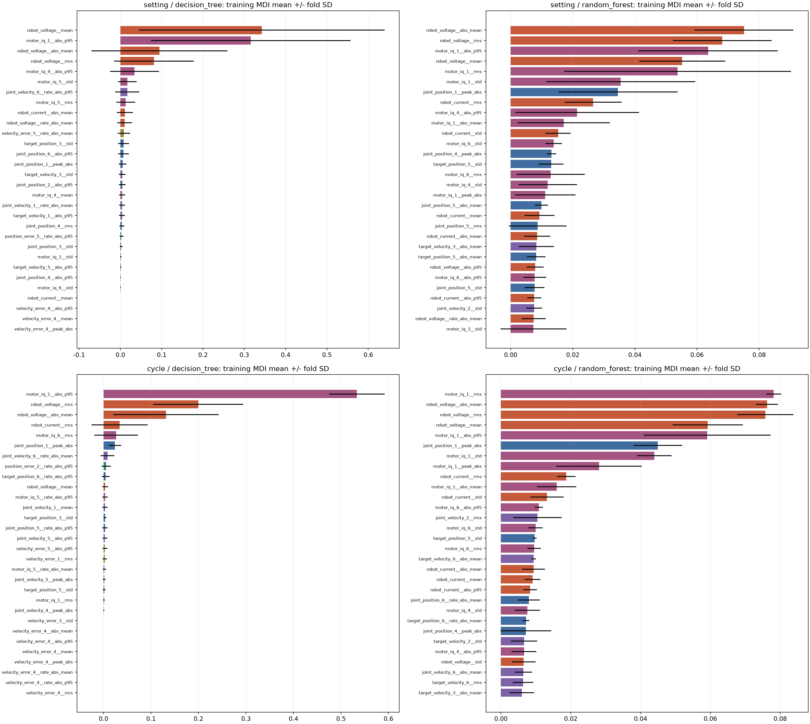
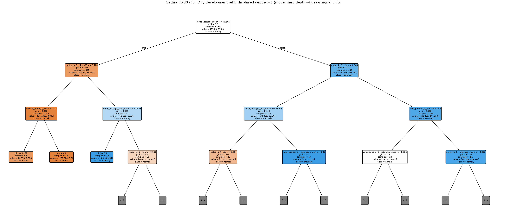
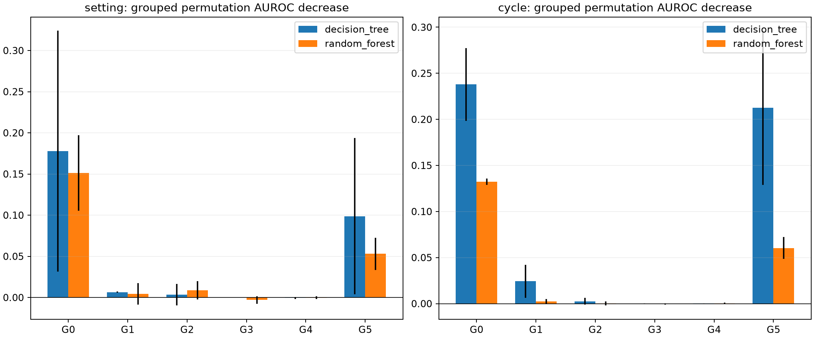
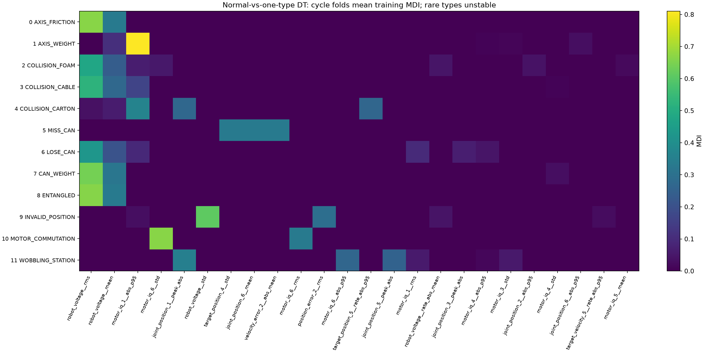
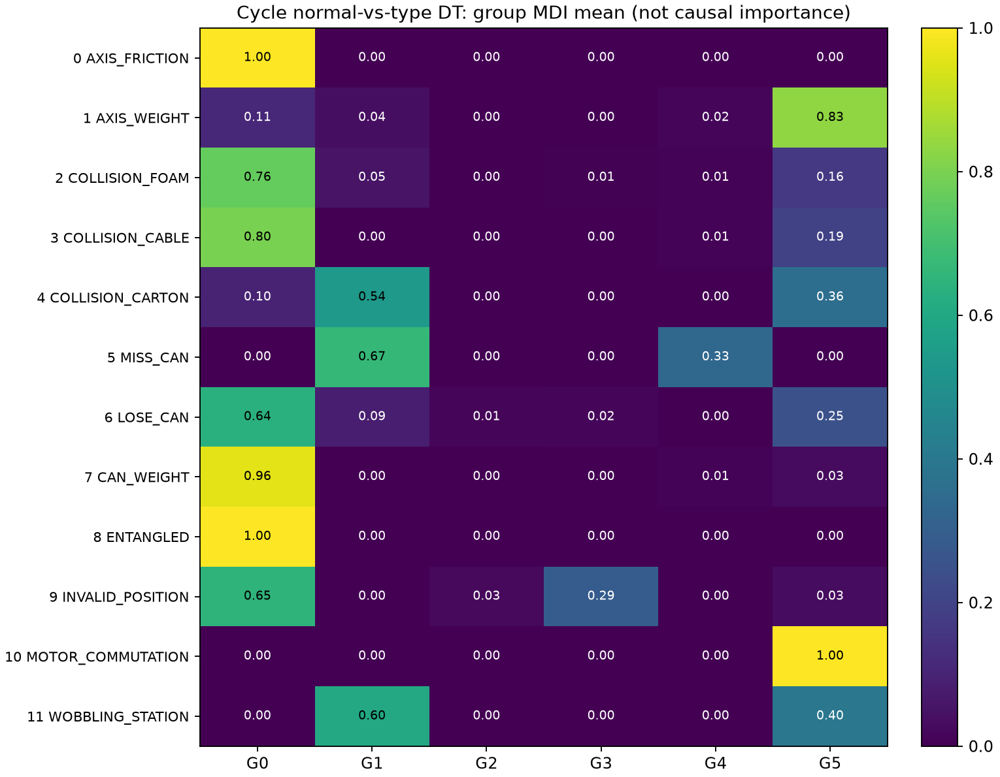
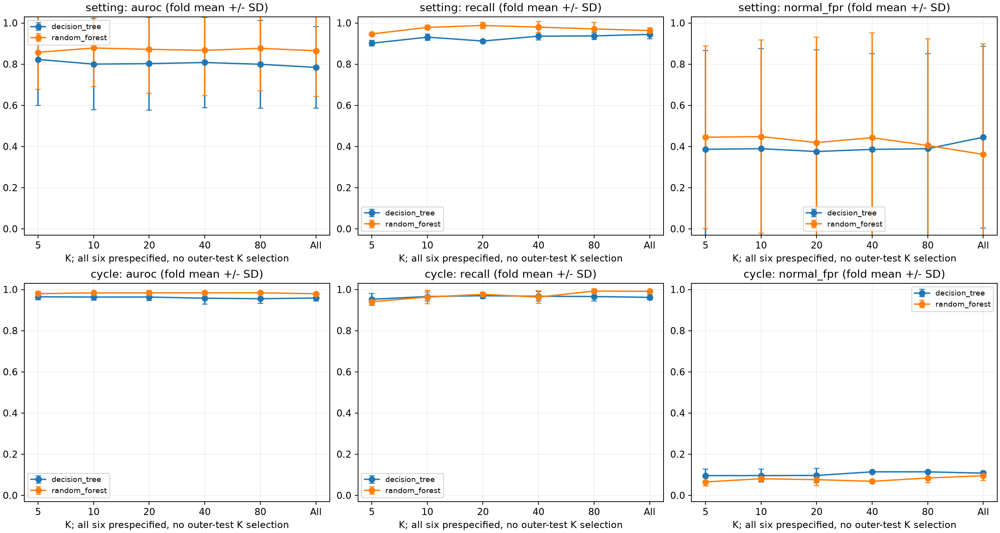
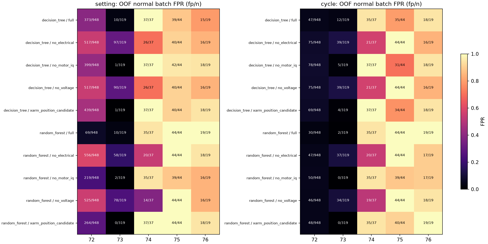

# Decision Tree 기반 Feature Importance 및 Feature Selection 분석

## 1. 분석 목적과 기존 Ablation Study와의 차이

이번 실험은 정상·이상 라벨을 사용하는 **지도학습 기반 탐색적 특징 선택**이다. 정상만 학습한 기존 이상 탐지 Baseline과 목적·분할·임계값이 다르다. 기존44신호×8통계=352 Cycle 특징 캐시를 읽었고, 원본 시계열을 다시 추출하지 않았다. 새로운 개별 특징을 생성하지 않았다. 기존 코드/결과/모델은 보존했다.

**공개 데이터는 이미 EDA·Baseline·Ablation에 반복 사용했다. 아래 외부 fold는 이번 선택 절차로부터 분리했지만, 최종 독립 검증 데이터가 아니다.** 중요도는 물리적 고장 원인 중요도가 아니며 xArm 전이·실시간 조기 탐지·유형 분류기·미래 위험·RUL을 입증하지 않는다. 평가 입력은 사이클 종료 후 계산한 요약이다.

핵심 관찰은 순위의 불안정성과 정상 배치 취약성이다. RF full의 외부 fold AUROC는 Cycle 평균0.979(SD0.008), setting 평균0.865(SD0.221)였다. setting fold2에서는 AUROC0.609·정상FPR0.980으로 저하됐다. 내부 선택 K가 이 문제를 일관되게 개선하지 못했다. 전체 pooled OOF 수치와 fold 평균을 구분해 읽어야 한다.

## 2. 사용 데이터 및 지도학습 분할 설계

전체2122사이클(정상1367/이상755), 12종 이상. 공식 enum을 사용했고 sample/category/setting/anomaly/action/active는 숫자 입력에서 제외했다. 전체 학습 과정을 재현하는 설정은 `feature_selection_protocol.json`, sample의 역할은 `supervised_splits.csv`에 저장했다.

- 외부3fold를 category 비율을 고려한 Cycle 분할과 StratifiedGroupKFold(setting)로 각각 구성했다. setting 분할은 외부 학습/평가 간 세부조건을 완전히 분리하고 정상72~76도 그룹으로 제외한다. 정상 PRE_A948개가 한 그룹이라 fold 크기가 불균형한 것은 분할 제약의 결과이며 점수를 보고 배정을 바꾸지 않았다.

- 각 외부 학습분에서20%를 임계값 보정으로 남기고, 나머지80%를 다시75:25로 특징 순위 학습/내부 K 검증으로 나눴다. 이 내부 분할은 category 층화 Cycle 분할이다. **엄격한 setting 분리는 외부 경계에만 보장**하며 내부에도 setting 독립성을 보장한 Nested Group CV는 아니다. 정상 setting이 적고 단일 setting 이상이 있어 내부는 제한된 Nested holdout으로 구성했다.

- 순위는 selection_fit에서만 구한다. K는 selection_validation AUROC 최대, 동점은 더 작은 입력을 선택한다. 선택된 순위를 고정한 채 두 부분을 합친 development에서 모델을 다시 학습한다. 별도 calibration에서 Balanced Accuracy 최대 임계값을 정하고 동점은 낮은 FPR, 높은 임계값 순으로 결정한다. 판정은 score>threshold다. 외부 평가에서 K/임계값/특징을 고르지 않았다.

- 결측은 selection_fit 중앙값으로 대체하며, 그 부분에서 모두 결측이거나 분산≤1e-12인 특징을 제거한다. 전처리를 이후에 다시 fit하지 않는다. 전체 데이터 기반 정규화·복제·오버샘플링은 없다. Tree에 스케일링은 적용하지 않았다. 유한값/제거 수는 감사표로 확인한다.

- 기존 Baseline의 정상 검증 FPR5% 임계값과 달리 이번 지도학습 임계값은 별도 내부 보정의 Balanced Accuracy를 최적화한다. FPR5% 보장이나 직접적 모델 우열 비교를 하지 않는다. 분류 확률이 이산적인 Tree는 임계값에 따라 Recall이 급변할 수 있다.

| protocol | fold | role | n_cycles | n_settings |
| --- | --- | --- | --- | --- |
| cycle | 0 | calibration | 283 | 58 |
| cycle | 0 | outer_test | 708 | 75 |
| cycle | 0 | selection_fit | 848 | 75 |
| cycle | 0 | selection_validation | 283 | 61 |
| cycle | 1 | calibration | 283 | 62 |
| cycle | 1 | outer_test | 707 | 75 |
| cycle | 1 | selection_fit | 849 | 77 |
| cycle | 1 | selection_validation | 283 | 64 |
| cycle | 2 | calibration | 283 | 65 |
| cycle | 2 | outer_test | 707 | 75 |
| cycle | 2 | selection_fit | 849 | 76 |
| cycle | 2 | selection_validation | 283 | 56 |
| setting | 0 | calibration | 190 | 47 |
| setting | 0 | outer_test | 1176 | 25 |
| setting | 0 | selection_fit | 567 | 52 |
| setting | 0 | selection_validation | 189 | 47 |
| setting | 1 | calibration | 314 | 46 |
| setting | 1 | outer_test | 555 | 24 |
| setting | 1 | selection_fit | 939 | 53 |
| setting | 1 | selection_validation | 314 | 49 |
| setting | 2 | calibration | 347 | 46 |
| setting | 2 | outer_test | 391 | 28 |
| setting | 2 | selection_fit | 1038 | 49 |
| setting | 2 | selection_validation | 346 | 46 |

실제 상수 처리와 정상/이상 수:

| protocol | fold | nominal_features | retained_features | all_missing_features | selector_fit_normal | selector_fit_anomaly | outer_normal | outer_anomaly |
| --- | --- | --- | --- | --- | --- | --- | --- | --- |
| setting | 0 | 352 | 339 | 0.000 | 251.000 | 316.000 | 948.000 | 228.000 |
| setting | 1 | 352 | 341 | 0.000 | 628.000 | 311.000 | 319.000 | 236.000 |
| setting | 2 | 352 | 339 | 0.000 | 760.000 | 278.000 | 100.000 | 291.000 |
| cycle | 0 | 352 | 337 | 0.000 | 547.000 | 301.000 | 456.000 | 252.000 |
| cycle | 1 | 352 | 337 | 0.000 | 547.000 | 302.000 | 455.000 | 252.000 |
| cycle | 2 | 352 | 339 | 0.000 | 547.000 | 302.000 | 456.000 | 251.000 |

외부 setting 배정(Cycle은 같은 setting이 학습에도 존재):

| protocol | fold | held_out_settings |
| --- | --- | --- |
| cycle | 0 | 0,1,2,3,4,5,6,7,8,9,10,11,12,13,14,15,16,17,19,20,21,22,23,24,25,26,27,28,29,30,31,32,33,34,35,37,38,39,40,41,42,43,44,45,46,47,48,49,50,51,52,53,54,55,56,57,58,59,60,61,62,63,64,65,66,67,68,69,70,71,72,73,74,75,76 |
| cycle | 1 | 0,1,2,3,4,5,6,7,8,9,10,11,12,13,14,15,16,17,18,19,21,22,23,24,25,26,27,28,29,30,31,32,33,34,35,36,37,38,39,40,41,42,43,44,45,46,47,48,49,50,51,52,53,54,55,56,57,58,59,60,61,62,63,64,65,67,68,69,70,71,72,73,74,75,76 |
| cycle | 2 | 0,1,2,3,4,5,7,8,9,10,11,12,13,14,15,16,17,18,19,20,21,22,23,24,25,26,27,28,29,30,31,32,33,34,35,36,37,38,39,40,41,42,43,44,45,46,47,48,49,50,52,53,54,55,56,57,58,59,60,61,62,63,64,65,66,67,68,69,70,71,72,73,74,75,76 |
| setting | 0 | 1,3,6,8,10,17,18,22,24,27,28,32,33,39,41,42,48,51,52,54,55,65,66,70,72 |
| setting | 1 | 0,7,12,13,20,23,25,29,30,31,34,35,38,43,47,49,50,56,59,63,64,68,69,73 |
| setting | 2 | 2,4,5,9,11,14,15,16,19,21,26,36,37,40,44,45,46,53,57,58,60,61,62,67,71,74,75,76 |

단일 setting인 MISS_CAN45, INVALID_POSITION61, ENTANGLED60은 동일 유형의 미관측 setting 학습/평가를 동시에 만들 수 없다. 해당 유형별 Group 모델의 부족한 역할은 건너뛰고 `category_group_limitations.csv`에 기록한다. 전체 정상/이상 Group 모델은 이런 유형을 학습에 없던 이상으로 평가할 수 있으나 해당 유형 지도학습 일반화와는 다르다.

| protocol | fold | category | reason | n_settings | note |
| --- | --- | --- | --- | --- | --- |
| setting | 0 | 5 | missing class in outer_test | 1 | single-setting categories cannot estimate unseen-setting same-type performance |
| setting | 0 | 8 | missing class in outer_test | 1 | single-setting categories cannot estimate unseen-setting same-type performance |
| setting | 0 | 9 | missing class in outer_test | 1 | single-setting categories cannot estimate unseen-setting same-type performance |
| setting | 1 | 5 | missing class in outer_test | 1 | single-setting categories cannot estimate unseen-setting same-type performance |
| setting | 1 | 8 | missing class in outer_test | 1 | single-setting categories cannot estimate unseen-setting same-type performance |
| setting | 1 | 9 | missing class in outer_test | 1 | single-setting categories cannot estimate unseen-setting same-type performance |
| setting | 2 | 5 | missing class in selection_fit,selection_validation,calibration | 1 | single-setting categories cannot estimate unseen-setting same-type performance |
| setting | 2 | 8 | missing class in selection_fit,selection_validation,calibration | 1 | single-setting categories cannot estimate unseen-setting same-type performance |
| setting | 2 | 9 | missing class in selection_fit,selection_validation,calibration | 1 | single-setting categories cannot estimate unseen-setting same-type performance |
## 3. Decision Tree Feature Importance 결과

고정 DT: max_depth4/min_samples_leaf5/class_weight=balanced/seed20261017. 이상30개 미만 유형은 depth2/leaf3으로 축소했다. 하이퍼파라미터 탐색은 없다. `feature_importance_decision_tree.csv`는 순위 학습 단계의 MDI·352중 남은 특징의 순위·분할 사용 여부·깊이·노드 수를 기록한다. 최종 재학습 Tree의 구조는 다를 수 있어 `tree_split_nodes.csv`에 stage를 구분했다. MDI가0인 특징의 순서는 원래 입력 순서로 정한 동점이며 중요도 증거가 아니다.

| feature | group | mean_importance | std_importance | positive_folds | top10_folds |
| --- | --- | --- | --- | --- | --- |
| robot_voltage__mean | G0 | 0.342 | 0.297 | 2 | 2 |
| motor_iq_1__abs_p95 | G5 | 0.316 | 0.242 | 3 | 3 |
| robot_voltage__abs_mean | G0 | 0.095 | 0.164 | 1 | 1 |
| robot_voltage__rms | G0 | 0.081 | 0.097 | 3 | 3 |
| motor_iq_4__abs_p95 | G5 | 0.034 | 0.059 | 1 | 1 |
| motor_iq_5__std | G5 | 0.017 | 0.023 | 2 | 2 |
| joint_velocity_6__rate_abs_p95 | G2 | 0.017 | 0.029 | 1 | 1 |
| motor_iq_5__rms | G5 | 0.013 | 0.023 | 1 | 1 |
| robot_current__abs_mean | G0 | 0.011 | 0.019 | 1 | 1 |
| robot_voltage__rate_abs_mean | G0 | 0.010 | 0.018 | 1 | 1 |

트리 그림은 setting fold0의 full development 재학습 모델을 깊이3까지만 표시한 예시다(실제 제한4). 정확한 모든 노드의 분할값과 사용 특징은 CSV에 있다. 스케일링하지 않은 원본 신호 통계의 문턱값이다. 로컬 공식 코드에는 신호별 단위 표가 없어 임의로 rad/A 등의 단위를 확정하지 않았으며 `unit`은 원본 신호 단위, 변화율은 그 단위/s로 기록했다. xArm에 이 문턱값을 복사하면 안 된다.

## 4. Random Forest 및 Permutation Importance 비교

고정 RF100트리/depth6/leaf5/max_features=sqrt/class_weight=balanced/seed20261017. 아래 전체 중요 특징10개는 **사전에 정한 setting 분할 RF full의 학습 MDI 평균**으로 정렬했다. 외부 성능이 가장 좋은 모델을 고른 목록이 아니다. Cycle·DT의 다른 순위와 Top10/20/30도 모두 CSV로 보존했다.

| feature | signal | statistic | group | mean_importance | std_importance | positive_folds | top10_folds |
| --- | --- | --- | --- | --- | --- | --- | --- |
| robot_voltage__abs_mean | robot_voltage | abs_mean | G0 | 0.075 | 0.016 | 3 | 3 |
| robot_voltage__rms | robot_voltage | rms | G0 | 0.068 | 0.016 | 3 | 3 |
| motor_iq_1__abs_p95 | motor_iq_1 | abs_p95 | G5 | 0.064 | 0.022 | 3 | 3 |
| robot_voltage__mean | robot_voltage | mean | G0 | 0.055 | 0.014 | 3 | 3 |
| motor_iq_1__rms | motor_iq_1 | rms | G5 | 0.054 | 0.037 | 3 | 2 |
| motor_iq_1__std | motor_iq_1 | std | G5 | 0.035 | 0.024 | 3 | 2 |
| joint_position_1__peak_abs | joint_position_1 | peak_abs | G1 | 0.035 | 0.019 | 3 | 2 |
| robot_current__rms | robot_current | rms | G0 | 0.027 | 0.009 | 3 | 2 |
| motor_iq_4__abs_p95 | motor_iq_4 | abs_p95 | G5 | 0.021 | 0.020 | 3 | 1 |
| motor_iq_1__abs_mean | motor_iq_1 | abs_mean | G5 | 0.017 | 0.015 | 3 | 2 |

이10개 중 전압 통계3개, iq 통계5개, 위치1개, 전체전류RMS1개가 포함됐다. 같은 신호의 여러 통계가 반복되므로 서로 독립적인10개 센서 정보를 발견했다는 뜻이 아니다. 특히 전압 통계가3개 fold 모두에서 Top10이라고 해서 물리적 고장 관련성을 보장하지 않는다.

Permutation은 full 최종 모델의 **외부 holdout 진단**이다. 외부 라벨로 계산하지만 특징/K/임계값을 바꾸는 데 사용하지 않았다. 각 외부 fold에서 정상/이상 비율을 유지한 최대256개를 고정 추출하고 각 특징을5회 섞어 AUROC 감소의 평균·반복 표준편차를 계산했다. 결과의 baseline AUROC는 이 부분집합 기준이며 전체 외부 AUROC와 다를 수 있다. 개별 특징과 G0~G5 그룹은 별도 행이며 그룹 안에서는 모든 열에 같은 사이클 순열을 적용해 내부 상관을 유지했다.

| protocol | algorithm | feature_or_group | mean_auroc_drop | fold_sd | mean_repeat_sd | validation_rows_min | validation_rows_max |
| --- | --- | --- | --- | --- | --- | --- | --- |
| cycle | decision_tree | G0 | 0.238 | 0.039 | 0.023 | 256 | 256 |
| cycle | decision_tree | G1 | 0.024 | 0.018 | 0.009 | 256 | 256 |
| cycle | decision_tree | G2 | 0.003 | 0.004 | 0.001 | 256 | 256 |
| cycle | decision_tree | G3 | -0.000 | 0.000 | 0.000 | 256 | 256 |
| cycle | decision_tree | G4 | 0.000 | 0.000 | 0.000 | 256 | 256 |
| cycle | decision_tree | G5 | 0.212 | 0.084 | 0.019 | 256 | 256 |
| cycle | random_forest | G0 | 0.132 | 0.003 | 0.014 | 256 | 256 |
| cycle | random_forest | G1 | 0.003 | 0.003 | 0.005 | 256 | 256 |
| cycle | random_forest | G2 | 0.000 | 0.002 | 0.006 | 256 | 256 |
| cycle | random_forest | G3 | -0.000 | 0.001 | 0.001 | 256 | 256 |
| cycle | random_forest | G4 | 0.000 | 0.001 | 0.001 | 256 | 256 |
| cycle | random_forest | G5 | 0.060 | 0.012 | 0.009 | 256 | 256 |
| setting | decision_tree | G0 | 0.178 | 0.146 | 0.022 | 256 | 256 |
| setting | decision_tree | G1 | 0.007 | 0.001 | 0.006 | 256 | 256 |
| setting | decision_tree | G2 | 0.004 | 0.013 | 0.006 | 256 | 256 |
| setting | decision_tree | G3 | -0.000 | 0.000 | 0.000 | 256 | 256 |
| setting | decision_tree | G4 | -0.001 | 0.001 | 0.000 | 256 | 256 |
| setting | decision_tree | G5 | 0.099 | 0.095 | 0.026 | 256 | 256 |
| setting | random_forest | G0 | 0.151 | 0.046 | 0.018 | 256 | 256 |
| setting | random_forest | G1 | 0.004 | 0.013 | 0.008 | 256 | 256 |
| setting | random_forest | G2 | 0.009 | 0.011 | 0.007 | 256 | 256 |
| setting | random_forest | G3 | -0.003 | 0.005 | 0.001 | 256 | 256 |
| setting | random_forest | G4 | -0.000 | 0.002 | 0.001 | 256 | 256 |
| setting | random_forest | G5 | 0.053 | 0.020 | 0.014 | 256 | 256 |

전체 Top10 MDI와 동일 특징의 단일 순열 중요도 대조(상관 대체로 감소량이 작을 수 있음):

| feature | mean_importance | positive_folds | top10_folds | permutation_auroc_drop_mean | permutation_repeat_sd_mean |
| --- | --- | --- | --- | --- | --- |
| robot_voltage__abs_mean | 0.075 | 3 | 3 | 0.029 | 0.004 |
| robot_voltage__rms | 0.068 | 3 | 3 | 0.034 | 0.006 |
| motor_iq_1__abs_p95 | 0.064 | 3 | 3 | 0.008 | 0.007 |
| robot_voltage__mean | 0.055 | 3 | 3 | 0.025 | 0.005 |
| motor_iq_1__rms | 0.054 | 3 | 2 | 0.004 | 0.004 |
| motor_iq_1__std | 0.035 | 3 | 2 | -0.001 | 0.005 |
| joint_position_1__peak_abs | 0.035 | 3 | 2 | -0.006 | 0.003 |
| robot_current__rms | 0.027 | 3 | 2 | -0.007 | 0.002 |
| motor_iq_4__abs_p95 | 0.021 | 3 | 1 | -0.005 | 0.002 |
| motor_iq_1__abs_mean | 0.017 | 3 | 2 | 0.002 | 0.002 |
개별 MDI가 크더라도 상관된 다른 특징이 대신 쓰이면 단일 특징 순열 감소는 작아질 수 있다. 그룹 순열도 그룹 간 상관으로 대체될 수 있다. 음수 중요도는 그대로 저장했고0으로 잘라 순위를 꾸미지 않았다. 반복 SD나 fold SD는 독립 표본에 대한 신뢰구간이 아니다.

## 5. 이상 유형별 중요도 차이

유형별 모델은 정상 vs 해당 이상으로 별도 학습한 DT다. 12-class 고장 진단기를 구현한 것이 아니다. 같은 외부/내부 sample 역할을 유지하며 충분한 정상·이상이 없는 역할이 있으면 건너뛴다. 파지 실패11/파지 위치 이상12/얽힘10개는 내부 학습 이상 수가 수 개라 순위가 매우 불안정한 참고 결과다.

유형별 Cycle 학습 MDI의 그룹 합 평균:

| category_name | G0 | G1 | G2 | G3 | G4 | G5 |
| --- | --- | --- | --- | --- | --- | --- |
| AXIS_FRICTION | 1.000 | 0.000 | 0.000 | 0.000 | 0.000 | 0.000 |
| AXIS_WEIGHT | 0.110 | 0.037 | 0.000 | 0.000 | 0.019 | 0.833 |
| CAN_WEIGHT | 0.960 | 0.002 | 0.000 | 0.000 | 0.008 | 0.030 |
| COLLISION_CABLE | 0.798 | 0.000 | 0.000 | 0.000 | 0.010 | 0.193 |
| COLLISION_CARTON | 0.100 | 0.538 | 0.000 | 0.000 | 0.000 | 0.361 |
| COLLISION_FOAM | 0.765 | 0.054 | 0.000 | 0.006 | 0.011 | 0.165 |
| ENTANGLED | 0.996 | 0.000 | 0.000 | 0.000 | 0.000 | 0.004 |
| INVALID_POSITION | 0.651 | 0.000 | 0.026 | 0.292 | 0.000 | 0.031 |
| LOSE_CAN | 0.636 | 0.085 | 0.012 | 0.017 | 0.000 | 0.250 |
| MISS_CAN | 0.000 | 0.667 | 0.000 | 0.000 | 0.333 | 0.000 |
| MOTOR_COMMUTATION | 0.002 | 0.000 | 0.000 | 0.000 | 0.000 | 0.998 |
| WOBBLING_STATION | 0.000 | 0.604 | 0.001 | 0.000 | 0.000 | 0.395 |

유형별 상위3 개별 특징(Cycle, full, 학습 fold 평균):

| category | category_name | feature | group | importance |
| --- | --- | --- | --- | --- |
| 0 | AXIS_FRICTION | robot_voltage__rms | G0 | 0.666 |
| 0 | AXIS_FRICTION | robot_voltage__mean | G0 | 0.333 |
| 0 | AXIS_FRICTION | motor_iq_1__abs_p95 | G5 | 0.000 |
| 1 | AXIS_WEIGHT | motor_iq_1__abs_p95 | G5 | 0.810 |
| 1 | AXIS_WEIGHT | robot_voltage__mean | G0 | 0.109 |
| 1 | AXIS_WEIGHT | joint_position_6__abs_p95 | G1 | 0.030 |
| 2 | COLLISION_FOAM | robot_voltage__rms | G0 | 0.481 |
| 2 | COLLISION_FOAM | robot_voltage__mean | G0 | 0.239 |
| 2 | COLLISION_FOAM | motor_iq_1__abs_p95 | G5 | 0.066 |
| 3 | COLLISION_CABLE | robot_voltage__rms | G0 | 0.526 |
| 3 | COLLISION_CABLE | robot_voltage__mean | G0 | 0.272 |
| 3 | COLLISION_CABLE | motor_iq_1__abs_p95 | G5 | 0.167 |
| 4 | COLLISION_CARTON | motor_iq_1__abs_p95 | G5 | 0.361 |
| 4 | COLLISION_CARTON | joint_position_1__peak_abs | G1 | 0.271 |
| 4 | COLLISION_CARTON | target_position_5__rate_abs_p95 | G1 | 0.267 |
| 5 | MISS_CAN | target_position_4__std | G1 | 0.333 |
| 5 | MISS_CAN | joint_position_6__mean | G1 | 0.333 |
| 5 | MISS_CAN | velocity_error_2__abs_mean | G4 | 0.333 |
| 6 | LOSE_CAN | robot_voltage__rms | G0 | 0.427 |
| 6 | LOSE_CAN | robot_voltage__mean | G0 | 0.209 |
| 6 | LOSE_CAN | motor_iq_1__rms | G5 | 0.096 |
| 7 | CAN_WEIGHT | robot_voltage__rms | G0 | 0.641 |
| 7 | CAN_WEIGHT | robot_voltage__mean | G0 | 0.319 |
| 7 | CAN_WEIGHT | motor_iq_4__std | G5 | 0.030 |
| 8 | ENTANGLED | robot_voltage__rms | G0 | 0.663 |
| 8 | ENTANGLED | robot_voltage__mean | G0 | 0.333 |
| 8 | ENTANGLED | motor_iq_2__rms | G5 | 0.004 |
| 9 | INVALID_POSITION | robot_voltage__std | G0 | 0.610 |
| 9 | INVALID_POSITION | position_error_2__rms | G3 | 0.292 |
| 9 | INVALID_POSITION | robot_voltage__rate_abs_mean | G0 | 0.041 |
| 10 | MOTOR_COMMUTATION | motor_iq_6__std | G5 | 0.665 |
| 10 | MOTOR_COMMUTATION | motor_iq_6__rms | G5 | 0.332 |
| 10 | MOTOR_COMMUTATION | robot_voltage__abs_mean | G0 | 0.001 |
| 11 | WOBBLING_STATION | joint_position_1__peak_abs | G1 | 0.350 |
| 11 | WOBBLING_STATION | motor_iq_6__abs_p95 | G5 | 0.268 |
| 11 | WOBBLING_STATION | joint_position_5__peak_abs | G1 | 0.254 |

실제 유형별 차이는 다음과 같다. 마찰의 전압 mean/RMS MDI 합은 약1.000, 작업 물체 무게의 전압 mean/RMS 합은 약0.960이었다. 관절 부착 하중은 `motor_iq_1__abs_p95`가 약0.810으로 컸다. 이는 대상 관절을 원인으로 찾아냈다는 뜻이 아니며 모든6관절을 입력한 분류기의 선택이다. 파지 실패는3개 fold에서 `joint_position_6__mean`, `target_position_4__std`, `velocity_error_2__abs_mean`으로 각각 달라졌다. 파지 위치 이상은 `robot_voltage__std` 약0.610과 `position_error_2__rms` 약0.292가 컸다. **이번 Tree에서는 위치 정보가 모든 파지 관련 유형에서 일관되게 우세하지 않았다.** 작은 표본과 전압·배치 혼입을 함께 봐야 한다.

유형별 full/전압 제외의 분리 외부 성능. n_folds는 실제 평가 가능한 수이고 n_test_anomaly는 그 범위에서 평가한 이상 수다. setting 부족으로 누락된 유형을0점으로 채우지 않았다:

| protocol | input_set | category | category_name | auroc_mean | recall_mean | normal_fpr_mean | n_folds | n_test_anomaly |
| --- | --- | --- | --- | --- | --- | --- | --- | --- |
| cycle | full | 0.000 | AXIS_FRICTION | 0.995 | 0.993 | 0.006 | 3 | 144.000 |
| cycle | full | 1.000 | AXIS_WEIGHT | 0.938 | 0.897 | 0.033 | 3 | 156.000 |
| cycle | full | 2.000 | COLLISION_FOAM | 0.877 | 0.806 | 0.052 | 3 | 72.000 |
| cycle | full | 3.000 | COLLISION_CABLE | 0.854 | 0.729 | 0.021 | 3 | 48.000 |
| cycle | full | 4.000 | COLLISION_CARTON | 0.906 | 0.863 | 0.050 | 3 | 22.000 |
| cycle | full | 5.000 | MISS_CAN | 0.860 | 0.500 | 0.000 | 3 | 11.000 |
| cycle | full | 6.000 | LOSE_CAN | 0.873 | 0.773 | 0.051 | 3 | 74.000 |
| cycle | full | 7.000 | CAN_WEIGHT | 0.963 | 0.938 | 0.018 | 3 | 80.000 |
| cycle | full | 8.000 | ENTANGLED | 0.805 | 0.611 | 0.002 | 3 | 10.000 |
| cycle | full | 9.000 | INVALID_POSITION | 0.660 | 0.000 | 0.000 | 3 | 12.000 |
| cycle | full | 10.000 | MOTOR_COMMUTATION | 0.982 | 0.955 | 0.004 | 3 | 89.000 |
| cycle | full | 11.000 | WOBBLING_STATION | 0.901 | 0.808 | 0.008 | 3 | 37.000 |
| cycle | no_voltage | 0.000 | AXIS_FRICTION | 0.915 | 0.854 | 0.044 | 3 | 144.000 |
| cycle | no_voltage | 1.000 | AXIS_WEIGHT | 0.910 | 0.859 | 0.053 | 3 | 156.000 |
| cycle | no_voltage | 2.000 | COLLISION_FOAM | 0.757 | 0.569 | 0.054 | 3 | 72.000 |
| cycle | no_voltage | 3.000 | COLLISION_CABLE | 0.776 | 0.562 | 0.031 | 3 | 48.000 |
| cycle | no_voltage | 4.000 | COLLISION_CARTON | 0.721 | 0.286 | 0.056 | 3 | 22.000 |
| cycle | no_voltage | 5.000 | MISS_CAN | 0.861 | 0.722 | 0.000 | 3 | 11.000 |
| cycle | no_voltage | 6.000 | LOSE_CAN | 0.847 | 0.677 | 0.018 | 3 | 74.000 |
| cycle | no_voltage | 7.000 | CAN_WEIGHT | 0.854 | 0.736 | 0.057 | 3 | 80.000 |
| cycle | no_voltage | 8.000 | ENTANGLED | 0.705 | 0.417 | 0.007 | 3 | 10.000 |
| cycle | no_voltage | 9.000 | INVALID_POSITION | 0.700 | 0.250 | 0.011 | 3 | 12.000 |
| cycle | no_voltage | 10.000 | MOTOR_COMMUTATION | 0.981 | 0.956 | 0.006 | 3 | 89.000 |
| cycle | no_voltage | 11.000 | WOBBLING_STATION | 0.901 | 0.808 | 0.005 | 3 | 37.000 |
| setting | full | 0.000 | AXIS_FRICTION | 0.952 | 0.978 | 0.073 | 3 | 144.000 |
| setting | full | 1.000 | AXIS_WEIGHT | 0.887 | 0.860 | 0.106 | 3 | 156.000 |
| setting | full | 2.000 | COLLISION_FOAM | 0.728 | 0.621 | 0.199 | 3 | 72.000 |
| setting | full | 3.000 | COLLISION_CABLE | 0.800 | 0.806 | 0.180 | 3 | 48.000 |
| setting | full | 4.000 | COLLISION_CARTON | 0.631 | 0.280 | 0.163 | 3 | 22.000 |
| setting | full | 6.000 | LOSE_CAN | 0.841 | 0.746 | 0.072 | 3 | 74.000 |
| setting | full | 7.000 | CAN_WEIGHT | 0.920 | 0.913 | 0.096 | 3 | 80.000 |
| setting | full | 10.000 | MOTOR_COMMUTATION | 0.910 | 0.844 | 0.023 | 3 | 89.000 |
| setting | full | 11.000 | WOBBLING_STATION | 0.672 | 0.233 | 0.026 | 3 | 37.000 |
| setting | no_voltage | 0.000 | AXIS_FRICTION | 0.827 | 0.750 | 0.091 | 3 | 144.000 |
| setting | no_voltage | 1.000 | AXIS_WEIGHT | 0.823 | 0.898 | 0.291 | 3 | 156.000 |
| setting | no_voltage | 2.000 | COLLISION_FOAM | 0.660 | 0.583 | 0.226 | 3 | 72.000 |
| setting | no_voltage | 3.000 | COLLISION_CABLE | 0.766 | 0.638 | 0.106 | 3 | 48.000 |
| setting | no_voltage | 4.000 | COLLISION_CARTON | 0.562 | 0.328 | 0.194 | 3 | 22.000 |
| setting | no_voltage | 6.000 | LOSE_CAN | 0.851 | 0.726 | 0.024 | 3 | 74.000 |
| setting | no_voltage | 7.000 | CAN_WEIGHT | 0.760 | 0.727 | 0.213 | 3 | 80.000 |
| setting | no_voltage | 10.000 | MOTOR_COMMUTATION | 0.952 | 0.933 | 0.030 | 3 | 89.000 |
| setting | no_voltage | 11.000 | WOBBLING_STATION | 0.673 | 0.344 | 0.026 | 3 | 37.000 |

위 표를 통해 파지 유형의 위치/오차, 관절 부착 하중의 전류/iq, 작업 물체 무게의 전압 집중 여부를 구분한다. 효과가 유형·모델·fold마다 다르면 일관된 물리 원인으로 일반화하지 않는다. 유형별 노드와 임계값은 해당 학습분에 종속된다.

## 6. 상관된 특징과 중요도 안정성

학습 fold 간 양의 MDI Top10 교집합/합집합(Jaccard) 및 전체 MDI 순위 Spearman:

| protocol | algorithm | jaccard_mean | jaccard_min | jaccard_max | spearman_mean |
| --- | --- | --- | --- | --- | --- |
| cycle | decision_tree | 0.261 | 0.250 | 0.267 | 0.416 |
| cycle | random_forest | 0.879 | 0.818 | 1.000 | 0.577 |
| setting | decision_tree | 0.155 | 0.111 | 0.176 | 0.227 |
| setting | random_forest | 0.417 | 0.250 | 0.667 | 0.573 |

RF의 양의 Top10 평균 Jaccard는 Cycle약0.879에서 setting약0.417로 감소했고, DT는 각각약0.261/0.155였다. 단일 Tree의 개별 특징 순위는 덜 안정적이었다. 이 값은 이번3fold의 기술 통계이며 모집단 안정성의 보장이 아니다.

같은 fold의 DT/RF 양의 Top10 중복:

| protocol | fold | input_set | k | jaccard | n_dt | n_rf |
| --- | --- | --- | --- | --- | --- | --- |
| cycle | 0 | full | 10 | 0.333 | 10 | 10 |
| cycle | 1 | full | 10 | 0.333 | 10 | 10 |
| cycle | 2 | full | 10 | 0.267 | 9 | 10 |
| setting | 0 | full | 10 | 0.176 | 10 | 10 |
| setting | 1 | full | 10 | 0.250 | 10 | 10 |
| setting | 2 | full | 10 | 0.250 | 10 | 10 |

상수로 제거된 특징은 전체 MDI 순위 비교에서0으로 채워 공통 축을 맞췄다. Jaccard에서는 MDI0인 임의 동점을 제외했으며 양의 특징 수 자체도 저장했다. Top5/10/20/30/40/80 안정성을 보존했고 유형별 안정성은 `category_importance_stability.csv`로 분리했다. 유형별 fold가1개 이하이면 안정성을 추정하지 않는다.

Spearman |상관|≥0.95를 사전 기준으로 selection_fit에서만 계산한 쌍을 `training_feature_correlations.csv`에 저장했다. mean/abs_mean/RMS/P95 등의 중복과 원신호/오차 상관을 검토하는 설명용이며 이 결과를 보고 외부 성능에 유리한 열을 제거하지 않았다. 원신호 G1/G2와 오차 G3/G4 사이 기준을 넘은 예시:

| protocol | fold | feature_a | feature_b | spearman |
| --- | --- | --- | --- | --- |
| cycle | 0 | joint_velocity_5__mean | velocity_error_5__mean | -1.000 |
| cycle | 1 | joint_velocity_6__mean | velocity_error_6__mean | -1.000 |
| setting | 1 | joint_velocity_1__mean | velocity_error_1__mean | -1.000 |
| cycle | 1 | target_velocity_3__rms | position_error_3__rms | 0.984 |
| cycle | 1 | target_velocity_3__rms | position_error_3__std | 0.984 |
| cycle | 1 | target_velocity_3__std | position_error_3__rms | 0.984 |
| cycle | 1 | target_velocity_3__std | position_error_3__std | 0.984 |
| cycle | 1 | joint_velocity_3__rms | position_error_3__rms | 0.984 |
| cycle | 1 | joint_velocity_3__rms | position_error_3__std | 0.984 |
| cycle | 1 | joint_velocity_3__std | position_error_3__rms | 0.984 |
| cycle | 1 | joint_velocity_3__std | position_error_3__std | 0.984 |
| cycle | 2 | target_velocity_6__rate_abs_mean | position_error_6__abs_mean | 0.980 |
| cycle | 1 | target_velocity_3__abs_p95 | position_error_3__std | 0.976 |
| cycle | 1 | target_velocity_3__abs_p95 | position_error_3__rms | 0.976 |
| cycle | 1 | target_position_3__rate_abs_p95 | position_error_3__std | 0.975 |

## 7. 상위 K개 특징만 사용한 성능 비교

K=5/10/20/40/80/전체를 **각 fold 내부의 각 모델 순위**로 고정해 평가했다. K개 중 양의 MDI가 부족하면 나머지를 원래 입력 순서의0중요도 특징으로 채우고 `zero_mdi_padding`을 기록했다. 특히 얕은 DT는 실제 분할 특징이 적으므로 Top80을80개 유효 특징의 발견으로 해석하지 않는다. 전체 입력의 외부 결과로 K를 다시 고르지 않는다.

모든 사전 고정 K의 fold 평균·표준편차 및 실제 입력 수:

| protocol | algorithm | input_set | k | auroc_mean | auroc_sd | recall_mean | normal_fpr_mean | balanced_accuracy_mean | pr_auc_ap_mean | n_features_min | n_features_max |
| --- | --- | --- | --- | --- | --- | --- | --- | --- | --- | --- | --- |
| cycle | decision_tree | full | 10 | 0.963 | 0.015 | 0.966 | 0.096 | 0.935 | 0.905 | 10 | 10 |
| cycle | decision_tree | full | 20 | 0.963 | 0.018 | 0.970 | 0.097 | 0.937 | 0.902 | 20 | 20 |
| cycle | decision_tree | full | 40 | 0.957 | 0.029 | 0.967 | 0.114 | 0.926 | 0.901 | 40 | 40 |
| cycle | decision_tree | full | 5 | 0.964 | 0.015 | 0.952 | 0.096 | 0.928 | 0.917 | 5 | 5 |
| cycle | decision_tree | full | 80 | 0.955 | 0.023 | 0.966 | 0.114 | 0.926 | 0.896 | 80 | 80 |
| cycle | decision_tree | full | all | 0.958 | 0.014 | 0.962 | 0.108 | 0.927 | 0.896 | 337 | 339 |
| cycle | random_forest | full | 10 | 0.983 | 0.006 | 0.963 | 0.080 | 0.941 | 0.961 | 10 | 10 |
| cycle | random_forest | full | 20 | 0.984 | 0.009 | 0.976 | 0.076 | 0.950 | 0.961 | 20 | 20 |
| cycle | random_forest | full | 40 | 0.984 | 0.009 | 0.963 | 0.068 | 0.947 | 0.962 | 40 | 40 |
| cycle | random_forest | full | 5 | 0.980 | 0.009 | 0.940 | 0.065 | 0.938 | 0.957 | 5 | 5 |
| cycle | random_forest | full | 80 | 0.984 | 0.008 | 0.992 | 0.084 | 0.954 | 0.961 | 80 | 80 |
| cycle | random_forest | full | all | 0.979 | 0.008 | 0.991 | 0.095 | 0.948 | 0.951 | 337 | 339 |
| setting | decision_tree | full | 10 | 0.800 | 0.222 | 0.931 | 0.389 | 0.771 | 0.768 | 10 | 10 |
| setting | decision_tree | full | 20 | 0.802 | 0.226 | 0.912 | 0.376 | 0.768 | 0.776 | 20 | 20 |
| setting | decision_tree | full | 40 | 0.808 | 0.221 | 0.936 | 0.386 | 0.775 | 0.779 | 40 | 40 |
| setting | decision_tree | full | 5 | 0.823 | 0.224 | 0.901 | 0.386 | 0.758 | 0.824 | 5 | 5 |
| setting | decision_tree | full | 80 | 0.799 | 0.213 | 0.937 | 0.389 | 0.774 | 0.775 | 80 | 80 |
| setting | decision_tree | full | all | 0.784 | 0.197 | 0.944 | 0.445 | 0.750 | 0.720 | 339 | 341 |
| setting | random_forest | full | 10 | 0.878 | 0.187 | 0.978 | 0.448 | 0.765 | 0.921 | 10 | 10 |
| setting | random_forest | full | 20 | 0.872 | 0.213 | 0.988 | 0.419 | 0.784 | 0.933 | 20 | 20 |
| setting | random_forest | full | 40 | 0.867 | 0.220 | 0.980 | 0.443 | 0.768 | 0.928 | 40 | 40 |
| setting | random_forest | full | 5 | 0.857 | 0.180 | 0.947 | 0.445 | 0.751 | 0.884 | 5 | 5 |
| setting | random_forest | full | 80 | 0.877 | 0.206 | 0.971 | 0.405 | 0.783 | 0.939 | 80 | 80 |
| setting | random_forest | full | all | 0.865 | 0.221 | 0.963 | 0.361 | 0.801 | 0.921 | 339 | 341 |

학습 내부에서 선택한 K 정책의 pooled OOF 성능(각 fold의 K가 다를 수 있음):

| protocol | algorithm | input_set | auroc | pr_auc_ap | recall | normal_fpr | balanced_accuracy | fp | n_normal | n_anomaly | fold_k |
| --- | --- | --- | --- | --- | --- | --- | --- | --- | --- | --- | --- |
| cycle | decision_tree | full | 0.967 | 0.922 | 0.966 | 0.097 | 0.934 | 133 | 1367 | 755 | 0:20;1:5;2:5 |
| cycle | random_forest | full | 0.980 | 0.950 | 0.964 | 0.073 | 0.946 | 100 | 1367 | 755 | 0:5;1:20;2:80 |
| setting | decision_tree | full | 0.883 | 0.754 | 0.925 | 0.216 | 0.854 | 295 | 1367 | 755 | 0:10;1:5;2:10 |
| setting | random_forest | full | 0.964 | 0.929 | 0.976 | 0.301 | 0.838 | 411 | 1367 | 755 | 0:40;1:10;2:all |

선택 전 full의 pooled OOF 성능:

| protocol | algorithm | input_set | k | auroc | pr_auc_ap | recall | normal_fpr | balanced_accuracy | fp | n_normal | n_anomaly | evidence |
| --- | --- | --- | --- | --- | --- | --- | --- | --- | --- | --- | --- | --- |
| cycle | decision_tree | full | all | 0.959 | 0.909 | 0.962 | 0.108 | 0.927 | 147 | 1367 | 755 | pooled OOF scores; fold-specific thresholds |
| cycle | random_forest | full | all | 0.979 | 0.949 | 0.991 | 0.095 | 0.948 | 130 | 1367 | 755 | pooled OOF scores; fold-specific thresholds |
| setting | decision_tree | full | all | 0.826 | 0.658 | 0.943 | 0.347 | 0.798 | 474 | 1367 | 755 | pooled OOF scores; fold-specific thresholds |
| setting | random_forest | full | all | 0.956 | 0.880 | 0.963 | 0.129 | 0.917 | 177 | 1367 | 755 | pooled OOF scores; fold-specific thresholds |

핵심 비교: Cycle/RF는 전체 AUROC0.979·Recall0.991·FPR0.095에서 내부선택 K(5/20/80) 정책의0.980·0.964·0.073으로 변했다. setting/RF는 전체0.956·0.963·0.129에서 내부선택 K(40/10/전체)의0.964·0.976·0.301로 변했다. **setting 분리에서는 AUROC가 유지되어도 오탐이 크게 증가했으므로 소수 특징만으로 운영 성능을 유지했다고 결론 낼 수 없다.** DT도 전체와 선택정책의 성능/FPR을 같은 표에서 비교해야 한다. 이 문단의 수치는 pooled OOF이며 외부 K 최적화 결과가 아니다.

OOF는 모든 사이클을 한 번씩 외부 평가한 예측이다. fold마다 학습 배치·확률 눈금·임계값이 달라 pooled AUROC는 fold AUROC 평균과 다를 수 있다. 따라서 위 두 표현을 함께 제시하며 모델 비교는 같은 프로토콜·알고리즘 안에서 한다. FPR/Recall은 각 fold의 내부 보정 임계값을 적용한 결과다. K 중 외부 결과가 가장 높은 행을 최종 K로 선택하지 않았다.

## 8. 전압과 정상 배치 차이에 대한 분석

입력 조건: full352, no_voltage344, no_electrical336, xarm_position_candidate160(G0+G1+G3), no_motor_iq304. 위치 중심 후보도 API 미확인이라는 조건부 구성이다. 속도까지 포함한 no_motor_iq는 별도 비교로 남겼다. 상수 제거 후 실제 수는 감사표/metrics에 있다.

전체 입력 조건별 pooled OOF 성능:

| protocol | algorithm | input_set | k | auroc | pr_auc_ap | recall | normal_fpr | balanced_accuracy | fp | n_normal | n_anomaly | evidence |
| --- | --- | --- | --- | --- | --- | --- | --- | --- | --- | --- | --- | --- |
| cycle | decision_tree | full | all | 0.959 | 0.909 | 0.962 | 0.108 | 0.927 | 147 | 1367 | 755 | pooled OOF scores; fold-specific thresholds |
| cycle | decision_tree | no_electrical | all | 0.896 | 0.786 | 0.862 | 0.143 | 0.860 | 195 | 1367 | 755 | pooled OOF scores; fold-specific thresholds |
| cycle | decision_tree | no_motor_iq | all | 0.925 | 0.865 | 0.919 | 0.124 | 0.898 | 169 | 1367 | 755 | pooled OOF scores; fold-specific thresholds |
| cycle | decision_tree | no_voltage | all | 0.895 | 0.783 | 0.861 | 0.143 | 0.859 | 195 | 1367 | 755 | pooled OOF scores; fold-specific thresholds |
| cycle | decision_tree | xarm_position_candidate | all | 0.938 | 0.885 | 0.922 | 0.119 | 0.902 | 162 | 1367 | 755 | pooled OOF scores; fold-specific thresholds |
| cycle | random_forest | full | all | 0.979 | 0.949 | 0.991 | 0.095 | 0.948 | 130 | 1367 | 755 | pooled OOF scores; fold-specific thresholds |
| cycle | random_forest | no_electrical | all | 0.947 | 0.876 | 0.901 | 0.121 | 0.890 | 165 | 1367 | 755 | pooled OOF scores; fold-specific thresholds |
| cycle | random_forest | no_motor_iq | all | 0.971 | 0.932 | 0.956 | 0.103 | 0.927 | 141 | 1367 | 755 | pooled OOF scores; fold-specific thresholds |
| cycle | random_forest | no_voltage | all | 0.949 | 0.879 | 0.893 | 0.118 | 0.887 | 161 | 1367 | 755 | pooled OOF scores; fold-specific thresholds |
| cycle | random_forest | xarm_position_candidate | all | 0.974 | 0.940 | 0.960 | 0.104 | 0.928 | 142 | 1367 | 755 | pooled OOF scores; fold-specific thresholds |
| setting | decision_tree | full | all | 0.826 | 0.658 | 0.943 | 0.347 | 0.798 | 474 | 1367 | 755 | pooled OOF scores; fold-specific thresholds |
| setting | decision_tree | no_electrical | all | 0.644 | 0.445 | 0.869 | 0.509 | 0.680 | 696 | 1367 | 755 | pooled OOF scores; fold-specific thresholds |
| setting | decision_tree | no_motor_iq | all | 0.777 | 0.541 | 0.919 | 0.364 | 0.778 | 497 | 1367 | 755 | pooled OOF scores; fold-specific thresholds |
| setting | decision_tree | no_voltage | all | 0.639 | 0.444 | 0.864 | 0.504 | 0.680 | 689 | 1367 | 755 | pooled OOF scores; fold-specific thresholds |
| setting | decision_tree | xarm_position_candidate | all | 0.781 | 0.545 | 0.915 | 0.391 | 0.762 | 535 | 1367 | 755 | pooled OOF scores; fold-specific thresholds |
| setting | random_forest | full | all | 0.956 | 0.880 | 0.963 | 0.129 | 0.917 | 177 | 1367 | 755 | pooled OOF scores; fold-specific thresholds |
| setting | random_forest | no_electrical | all | 0.860 | 0.743 | 0.906 | 0.509 | 0.698 | 696 | 1367 | 755 | pooled OOF scores; fold-specific thresholds |
| setting | random_forest | no_motor_iq | all | 0.939 | 0.862 | 0.934 | 0.228 | 0.853 | 311 | 1367 | 755 | pooled OOF scores; fold-specific thresholds |
| setting | random_forest | no_voltage | all | 0.862 | 0.738 | 0.898 | 0.495 | 0.701 | 677 | 1367 | 755 | pooled OOF scores; fold-specific thresholds |
| setting | random_forest | xarm_position_candidate | all | 0.944 | 0.873 | 0.977 | 0.266 | 0.856 | 363 | 1367 | 755 | pooled OOF scores; fold-specific thresholds |

각 조건의 fold 평균도 `feature_selection_fold_summary.csv`에 보존했다. 전압 제외에 따라 중요도가 다른 상관 특징으로 이동할 수 있으며 성능 저하는 전압의 인과적 고장 감지를 입증하지 않는다.

정상 배치별 fp/n. setting 프로토콜은 모든 행이 해당 배치 미학습 평가이고 Cycle은 같은 배치가 학습에도 존재한다:

| protocol | algorithm | input_set | setting | variant_name | unseen_setting | false_positives | n_normal | normal_fpr |
| --- | --- | --- | --- | --- | --- | --- | --- | --- |
| cycle | decision_tree | full | 72 | PRE_A | False | 47 | 948 | 0.050 |
| cycle | decision_tree | full | 73 | PRE_B | False | 12 | 319 | 0.038 |
| cycle | decision_tree | full | 74 | BETWEEN_A | False | 35 | 37 | 0.946 |
| cycle | decision_tree | full | 75 | BETWEEN_B | False | 35 | 44 | 0.795 |
| cycle | decision_tree | full | 76 | BETWEEN_C | False | 18 | 19 | 0.947 |
| cycle | decision_tree | no_voltage | 72 | PRE_A | False | 75 | 948 | 0.079 |
| cycle | decision_tree | no_voltage | 73 | PRE_B | False | 39 | 319 | 0.122 |
| cycle | decision_tree | no_voltage | 74 | BETWEEN_A | False | 21 | 37 | 0.568 |
| cycle | decision_tree | no_voltage | 75 | BETWEEN_B | False | 44 | 44 | 1.000 |
| cycle | decision_tree | no_voltage | 76 | BETWEEN_C | False | 16 | 19 | 0.842 |
| cycle | decision_tree | xarm_position_candidate | 72 | PRE_A | False | 69 | 948 | 0.073 |
| cycle | decision_tree | xarm_position_candidate | 73 | PRE_B | False | 4 | 319 | 0.013 |
| cycle | decision_tree | xarm_position_candidate | 74 | BETWEEN_A | False | 37 | 37 | 1.000 |
| cycle | decision_tree | xarm_position_candidate | 75 | BETWEEN_B | False | 34 | 44 | 0.773 |
| cycle | decision_tree | xarm_position_candidate | 76 | BETWEEN_C | False | 18 | 19 | 0.947 |
| cycle | random_forest | full | 72 | PRE_A | False | 30 | 948 | 0.032 |
| cycle | random_forest | full | 73 | PRE_B | False | 2 | 319 | 0.006 |
| cycle | random_forest | full | 74 | BETWEEN_A | False | 35 | 37 | 0.946 |
| cycle | random_forest | full | 75 | BETWEEN_B | False | 44 | 44 | 1.000 |
| cycle | random_forest | full | 76 | BETWEEN_C | False | 19 | 19 | 1.000 |
| cycle | random_forest | no_voltage | 72 | PRE_A | False | 46 | 948 | 0.049 |
| cycle | random_forest | no_voltage | 73 | PRE_B | False | 34 | 319 | 0.107 |
| cycle | random_forest | no_voltage | 74 | BETWEEN_A | False | 19 | 37 | 0.514 |
| cycle | random_forest | no_voltage | 75 | BETWEEN_B | False | 44 | 44 | 1.000 |
| cycle | random_forest | no_voltage | 76 | BETWEEN_C | False | 18 | 19 | 0.947 |
| cycle | random_forest | xarm_position_candidate | 72 | PRE_A | False | 48 | 948 | 0.051 |
| cycle | random_forest | xarm_position_candidate | 73 | PRE_B | False | 0 | 319 | 0.000 |
| cycle | random_forest | xarm_position_candidate | 74 | BETWEEN_A | False | 35 | 37 | 0.946 |
| cycle | random_forest | xarm_position_candidate | 75 | BETWEEN_B | False | 40 | 44 | 0.909 |
| cycle | random_forest | xarm_position_candidate | 76 | BETWEEN_C | False | 19 | 19 | 1.000 |
| setting | decision_tree | full | 72 | PRE_A | True | 373 | 948 | 0.393 |
| setting | decision_tree | full | 73 | PRE_B | True | 10 | 319 | 0.031 |
| setting | decision_tree | full | 74 | BETWEEN_A | True | 37 | 37 | 1.000 |
| setting | decision_tree | full | 75 | BETWEEN_B | True | 39 | 44 | 0.886 |
| setting | decision_tree | full | 76 | BETWEEN_C | True | 15 | 19 | 0.789 |
| setting | decision_tree | no_voltage | 72 | PRE_A | True | 517 | 948 | 0.545 |
| setting | decision_tree | no_voltage | 73 | PRE_B | True | 90 | 319 | 0.282 |
| setting | decision_tree | no_voltage | 74 | BETWEEN_A | True | 26 | 37 | 0.703 |
| setting | decision_tree | no_voltage | 75 | BETWEEN_B | True | 40 | 44 | 0.909 |
| setting | decision_tree | no_voltage | 76 | BETWEEN_C | True | 16 | 19 | 0.842 |
| setting | decision_tree | xarm_position_candidate | 72 | PRE_A | True | 439 | 948 | 0.463 |
| setting | decision_tree | xarm_position_candidate | 73 | PRE_B | True | 1 | 319 | 0.003 |
| setting | decision_tree | xarm_position_candidate | 74 | BETWEEN_A | True | 37 | 37 | 1.000 |
| setting | decision_tree | xarm_position_candidate | 75 | BETWEEN_B | True | 40 | 44 | 0.909 |
| setting | decision_tree | xarm_position_candidate | 76 | BETWEEN_C | True | 18 | 19 | 0.947 |
| setting | random_forest | full | 72 | PRE_A | True | 69 | 948 | 0.073 |
| setting | random_forest | full | 73 | PRE_B | True | 10 | 319 | 0.031 |
| setting | random_forest | full | 74 | BETWEEN_A | True | 35 | 37 | 0.946 |
| setting | random_forest | full | 75 | BETWEEN_B | True | 44 | 44 | 1.000 |
| setting | random_forest | full | 76 | BETWEEN_C | True | 19 | 19 | 1.000 |
| setting | random_forest | no_voltage | 72 | PRE_A | True | 525 | 948 | 0.554 |
| setting | random_forest | no_voltage | 73 | PRE_B | True | 78 | 319 | 0.245 |
| setting | random_forest | no_voltage | 74 | BETWEEN_A | True | 14 | 37 | 0.378 |
| setting | random_forest | no_voltage | 75 | BETWEEN_B | True | 44 | 44 | 1.000 |
| setting | random_forest | no_voltage | 76 | BETWEEN_C | True | 16 | 19 | 0.842 |
| setting | random_forest | xarm_position_candidate | 72 | PRE_A | True | 264 | 948 | 0.278 |
| setting | random_forest | xarm_position_candidate | 73 | PRE_B | True | 0 | 319 | 0.000 |
| setting | random_forest | xarm_position_candidate | 74 | BETWEEN_A | True | 37 | 37 | 1.000 |
| setting | random_forest | xarm_position_candidate | 75 | BETWEEN_B | True | 44 | 44 | 1.000 |
| setting | random_forest | xarm_position_candidate | 76 | BETWEEN_C | True | 18 | 19 | 0.947 |

RF full에서 정상 BETWEEN_A는35/37(94.6%), BETWEEN_B는44/44(100%), BETWEEN_C는19/19(100%) 오탐이었다. **이는 같은 배치가 학습에도 들어간 Cycle 분할에서도 나타났다.** 미관측 배치 문제뿐 아니라 이 모델·전체 보정 규칙이 소수 정상 배치를 충분히 보호하지 못하는 문제도 있다. 단순 Cycle AUROC만으로 배치 안정성이 확보됐다고 볼 수 없다. 전압을 제외한 setting/RF full의 AUROC는0.956→0.862, FPR은0.129→0.495로 바뀌었다. 전압 제거만으로 정상 배치 문제가 해결되지 않았으며 원인 분리나 보정을 달성한 것도 아니다.

특히 setting fold2는 정상74/75/76을 모두 학습에서 제외했고 정상98/100개를 오탐했다. 해당 fold의 RF full AUROC0.609, Recall0.959, FPR0.980이다. setting의 fold 평균 AUROC0.865±0.221과 pooled OOF0.956은 크게 다르다. 큰 PRE_A/PRE_B 그룹에서 높은 순위 분리가 나오는 반면 소수 정상 배치에서는 실패한 결과를 pooled 수치 하나로 요약하면 낙관적으로 보일 수 있다. 이 fold에서는 이상 setting도 동시에 제외됐으므로 성능 저하의 원인을 정상 배치 하나로 인과 분해할 수는 없다.

PRE_A948개가 한 외부 fold에 몰리고 다른 정상 배치는 표본이 작다. 미학습 배치의 높은 FPR은 공개 데이터 내 분포 이동의 증거이며, 원인 분리나 완화 효과의 증거는 아니다. 반복 사용한 데이터에서 배치 이동을 진단한 결과로 해석한다. 전압-배치 관계는 기존 `results_07_fault_type_action/cycle_normal_batch_shift.csv`에도 기록되어 있다.

## 9. 기존 비지도 모델과의 관계

정상711개 학습/237개 임계값/정상419+이상755 평가라는 기존 Baseline은 보존했다. 이번 지도학습 선택에는 그 평가 이상들이 fold에 따라 학습으로 들어간다. 선택한 특징을 그대로 기존 평가755개에 재사용하면 선택 단계의 라벨 누수가 생긴다. **이번에는 비지도 특징 이전 실험을 생략했다.** 새 독립 선택용 이상 데이터 또는 비지도 평가 이상과 완전히 분리된 사전 특징 선택 집합이 필요하다. 이번 지도학습 점수를 기존 비지도 Baseline보다 우수하다는 증거로 제시하지 않는다.

## 10. xArm 적용 공통 특징 후보 우선순위

아래는 setting 분할 RF의 **위치 중심 조건부 후보 입력160개 안에서** 학습 MDI 평균이 높은10개다. 전체352의 Top10과 별도다. 높은 공개데이터 중요도만으로 센서 확정·축 대응·전이 성공을 주장하지 않는다. 외부 전류/전압은 INA226 계측 후보이고 실제 대역폭·오차·샘플링률을 측정해야 한다. 위치/목표/오차는 실제 피드백 API와 읽기 주기 확인이 선행되어야 한다.

| feature | signal | statistic | group | mean_importance | std_importance | positive_folds | top10_folds |
| --- | --- | --- | --- | --- | --- | --- | --- |
| robot_voltage__mean | robot_voltage | mean | G0 | 0.112 | 0.010 | 3 | 3 |
| robot_voltage__abs_mean | robot_voltage | abs_mean | G0 | 0.112 | 0.006 | 3 | 3 |
| robot_voltage__rms | robot_voltage | rms | G0 | 0.107 | 0.008 | 3 | 3 |
| joint_position_1__peak_abs | joint_position_1 | peak_abs | G1 | 0.064 | 0.038 | 3 | 2 |
| robot_current__std | robot_current | std | G0 | 0.044 | 0.012 | 3 | 3 |
| robot_current__rms | robot_current | rms | G0 | 0.036 | 0.002 | 3 | 3 |
| robot_current__mean | robot_current | mean | G0 | 0.027 | 0.007 | 3 | 3 |
| robot_current__abs_p95 | robot_current | abs_p95 | G0 | 0.026 | 0.003 | 3 | 2 |
| joint_position_4__peak_abs | joint_position_4 | peak_abs | G1 | 0.025 | 0.003 | 3 | 3 |
| joint_position_5__std | joint_position_5 | std | G1 | 0.022 | 0.002 | 3 | 1 |

센서 계열의 사전 확보 순서는 전체 전류의 RMS/평균/표준편차/절대 피크 및 변화 특징, 전압의 평균·변동을 조건 기록과 함께 확보하고, 가능하면 목표·실제 위치와 오차를 확인하는 것이다. 전압은 배치 변동 감시용으로도 기록하되 고장 원인 특징으로 확정하지 않는다. 변화율은 주기·타임스탬프 오차·노이즈에 민감하다. 위10개 밖의 전류 통계도 실측에서 비교할 기본 후보이며 공개 데이터 순위가 낮다고 수집에서 제외하지 않는다. 속도·속도오차는 읽기/차분 추정 검증 후 확장한다.

장비별 정상 대비 변화/Action별 특징·지속시간은 기존352개에 없어 이번 중요도를 측정하지 않았다. ADXL345 진동도 없으며 효과를 추정하지 않았다. motor_iq는 산업용 참고 신호로 INA226 DC전류와 다르며 xArm 필수 입력으로 확정하지 않는다.

## 11. 분석의 한계 및 후속 검증 계획

- 3개 외부fold와 내부 holdout에 한정한 탐색이다. 새로운 독립 검증이 아니며 작은 이상 유형에서는 순위·성능·임계값이 크게 흔들릴 수 있다. 단일 setting 유형의 Group 일반화와 안정성을 계산할 수 없는 범위를 명시했다.

- 개별 MDI는 상관·연속값 분포·트리의 선택 경쟁에 민감하다. 그룹 순열도 상관의 대체 가능성과 배치 교란을 제거하지 못한다. 지표의 높은 값과 안정적인 물리 원인은 구분해야 한다.

- 목표 위치·실제 위치 통계는 작업 경로/제어 반응의 차이를 나타낼 수도 있다. 높은 위치 중요도를 실제 기계 고장의 직접 신호로 단정하지 않는다. 일부 단일 순열 중요도는 음수였으며, 섞은 뒤 성능이 소폭 좋아지는 현상을 센서가 물리적으로 해롭다는 뜻으로 해석하지 않는다.

- K 선택용 내부 검증과 별도 임계값 보정, 외부 평가는 분리했다. 다만 내부는 Cycle 분할이고 내부 K 검증을 반복적으로 재사용하므로 완전한 다중 Group Nested CV보다 제한적이다. 하이퍼파라미터는 고정하고 외부 결과를 보고 바꾸지 않았다.

- xArm에서 여러 날짜·전원 조건·작업 조건의 정상 기록과 안전·정격 확인 후 조건 변화를 별도 수집한다. API/주기/동기화/정답 기록을 먼저 검증하고, 특징·K·임계값을 고정한 뒤 미사용 수집 배치에서 평가해야 한다. 공개 Yu-Cobot 결과를 xArm 성능으로 해석하지 않는다.

- 현재 결과는 정상/이상 분류 및 특징 선택의 참고다. 온라인 조기 탐지, 특정 고장 원인의 확정 진단, 장비 간 전이, 미래 K-cycle 위험, 자연 열화/RUL을 구현하거나 검증하지 않았다.

아래 최종 표의 이상 유형은 Cycle 유형별 학습 DT에서 해당 특징이 양의 Top10에 한 번이라도 나타난 category다. 안정성은 위치 중심 setting/RF의3개 학습 fold 기준이며, 개별 특징의 채택을 확정하는 표가 아니다. 전체 상위10개는4절, 실제 적용을 고려한 우선 검증 후보는 아래와 같다.

| 순위 | 개별 특징 | 소속 그룹 | 중요하게 나타난 이상 유형 | 중요도 안정성 | xArm 측정 가능성 | 최종 판단 |
| --- | --- | --- | --- | --- | --- | --- |
| 1 | robot_voltage__mean | G0 | 0,1,2,3,4,6,7,8,10 | 양의 MDI 3/3; Top10 3/3 | 외부 전압 센서 후보; 배치 의존 주의 | 조건부 우선 검증 후보; 확정 아님 |
| 2 | robot_voltage__abs_mean | G0 | 10 | 양의 MDI 3/3; Top10 3/3 | 외부 전압 센서 후보; 배치 의존 주의 | 조건부 우선 검증 후보; 확정 아님 |
| 3 | robot_voltage__rms | G0 | 0,2,3,4,6,7,8 | 양의 MDI 3/3; Top10 3/3 | 외부 전압 센서 후보; 배치 의존 주의 | 조건부 우선 검증 후보; 확정 아님 |
| 4 | joint_position_1__peak_abs | G1 | 4,7,11 | 양의 MDI 3/3; Top10 2/3 | 목표/피드백 API·주기 확인 필요 | 조건부 우선 검증 후보; 확정 아님 |
| 5 | robot_current__std | G0 | 10 | 양의 MDI 3/3; Top10 3/3 | 외부 전류 센서 후보; 주기 미확인 | 조건부 우선 검증 후보; 확정 아님 |
| 6 | robot_current__rms | G0 | 1 | 양의 MDI 3/3; Top10 3/3 | 외부 전류 센서 후보; 주기 미확인 | 조건부 우선 검증 후보; 확정 아님 |
| 7 | robot_current__mean | G0 | 없음 | 양의 MDI 3/3; Top10 3/3 | 외부 전류 센서 후보; 주기 미확인 | 조건부 우선 검증 후보; 확정 아님 |
| 8 | robot_current__abs_p95 | G0 | 3 | 양의 MDI 3/3; Top10 2/3 | 외부 전류 센서 후보; 주기 미확인 | 조건부 우선 검증 후보; 확정 아님 |
| 9 | joint_position_4__peak_abs | G1 | 없음 | 양의 MDI 3/3; Top10 3/3 | 목표/피드백 API·주기 확인 필요 | 조건부 우선 검증 후보; 확정 아님 |
| 10 | joint_position_5__std | G1 | 1 | 양의 MDI 3/3; Top10 1/3 | 목표/피드백 API·주기 확인 필요 | 조건부 우선 검증 후보; 확정 아님 |
